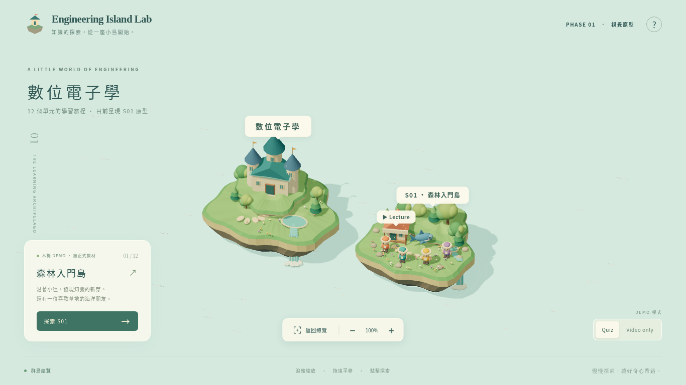
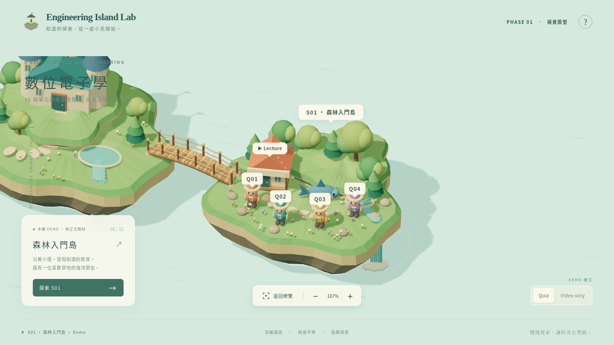
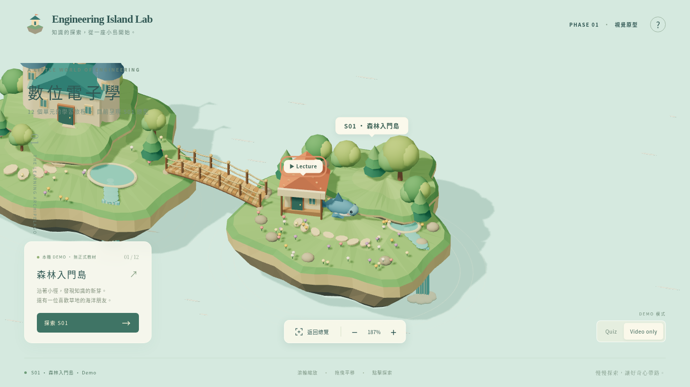
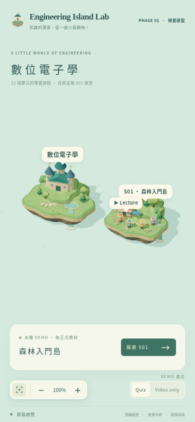

# Phase 0／1 交付與驗收紀錄

日期：2026-10-29（台北）。歷史紀錄：教師已在後續 Phase 2 指示確認 Windows 11 實機驗收通過（含木橋），PR #1 已合併。以下保留 Phase 1 交付時的測試及截圖紀錄。

## 基準與範圍

- 遠端 `chingchechung/engineering-island-lab`，main 起點 `d917afd`，分支 `feat/phase-0-1-island-prototype`。
- 已完整讀取 `CODEX_START_HERE.md`、PROJECT_SPEC、CONTENT_AND_RELEASE、PHASE_PLAN、STYLE_REFERENCES，並查看四張圖；保留規格及參考原檔不變。
- 遠端起點只有規格文件，本機已有未追蹤的初始化程式。沿用 Node 24.19.0／npm 11.9.0／Vite 8.3.5／Three.js 0.186.1，將初始化環境與原型一起納入功能分支。
- 初始化基準 `npm test`：5/5；`npm run build`：通過，原本已有 Three.js >500 kB bundle 提示。
- 新增固定 Playwright 1.64.1 作為瀏覽器測試依賴；未升級 Vite／Three.js。

## 已完成

- AGENTS、Plan、README 規範、模組邊界、分階段待辦與教師驗收清單。
- 同一連續 3D 場景：學院塔樓／中文課名、自然分層岩岸、草丘、樹木、花草、步道、水池與小瀑布，S01 Lecture 小屋和四名彩色探索者。
- 微拱木橋連接既有兩岸，平面略彎、暖色木板、細木柱與繩欄；純視覺元素，未加入互動／角色通行／碰撞／導航，也未移動島嶼或改變相機。
- 固定約 42° 正交相機；連續平滑滾輪／按鈕縮放、拖曳平移、地形／標牌點擊聚焦、返回總覽、鍵盤 Home／Esc／+/−。
- click/drag 以最大位移 6px 分辨，離開又回來不當點擊；cancel／多指操作不觸發內容。
- Q01–Q04 頭頂標牌及衣服識別；聚焦顯示細節，原生 dialog 提供誠實的 Demo 說明、焦點回復及背景事件隔離。
- 鯊魚依時間自主跳動，無互動目標、hover、餵食或行為控制；視窗開啟時照常活動。
- 本機明確 Demo 開關、Quiz／Video only 切換；video-only 完全不建立 NPC 幾何／Q 標籤／拾取目標。
- JSON 基本契約、空白正式 Manifest、相對 Apache 子目錄載入；正式建置無法以 query 啟用本機 Demo。

## 實際驗證

| 檢查 | 結果 | 內容 |
|---|---|---|
| `npm test` | 22/22 通過 | 設定 1/12/15、非法值、空 manifest、根／子目錄及 HTTP／JSON 錯誤、自然地貌、模式、相機、click/drag、裝飾物無拾取、橋端落岸／曲線／不遮地標 |
| `npm run build` | 通過 | 靜態 dist；仍有 >500 kB chunk 提示（主 JS 約 593 kB，gzip 約 154 kB） |
| `npm run test:smoke` | 通過 | Apache 型 `/~wildwolf/engineering-island-lab/` 下 HTML／JS／CSS／favicon／JSON／空 Manifest |
| `npm run test:browser` | 12/12 通過 | Linux Chromium + 真實 WebGL 渲染（SwiftShader），1366×768 與 390×844 |
| 額外模型拾取檢查 | 通過 | 直接點 Q03 模型開 Q03 占位視窗；直接點 Lecture 建物開小屋占位視窗 |
| Windows 11 Chrome／Edge | 待教師驗收 | 本環境為 Linux，不能聲稱 Windows 實測；請依 README 指令及 10 項檢查表驗收 |

12 項瀏覽器驗收包含：Quiz 的四名 NPC／動物不在拾取表、標牌聚焦與四題可讀、Modal 滾輪／鍵盤隔離及 Esc 焦點回復、Lecture 無外部教學連結、拖曳無誤觸、滾輪／返回總覽、video-only、切換後互動、窄視窗、預設入口保持鎖定且不 fetch 題庫、零 JavaScript／Console error、正式包於子目錄渲染且無 Demo。作業系統軟體 GPU 的驅動效能訊息不當作應用錯誤；一般筆電 FPS 待實機檢查。

自動化首輪曾因測試腳本把 hidden loader 等成 visible 而逾時，已將等待條件改為 attached；正式入口當時已正確載入，修正後整套通過。Three.js 移除的 PCFSoftShadowMap 設定已改成目前支援的 PCFShadowMap。

## 畫面證據

下列圖為本專案實際瀏覽器截圖；動畫時間點可能略有不同，未使用參考圖或第三方模型作為網站素材。

### 雙島總覽（木橋修訂後）

### S01 聚焦

### Video only

### 窄視窗

## 木橋修訂驗收

本輪沿用 Draft PR #1；只增加景觀橋及對應測試、文件與截圖。新增三項 Node 測試驗證橋兩端有實際島體承接、橋有垂直微拱及平面弧度、橋在既有總覽範圍內、兩種模式都排除橋的拾取／動作，以及朝向島名標牌、Lecture 和 Q01–Q04 的相機射線不被橋遮住。既有 12 項瀏覽器操作回歸通過，另以瀏覽器直接操作橋面中央，確認無專屬 hover／點擊視窗，拖曳平移及滾輪縮放仍正常。

教師請用原本 `npm run demo` 的 Windows Chrome／Edge 流程，加驗：

1. 總覽中木橋明確串接兩岸，細欄杆與木色不壓過主島和 S01。
2. 聚焦或放大後，橋面弧線、分片木板、繩欄和接岸自然；無硬直公路感。
3. 兩島標牌、小屋、四位 NPC 不被橋擋住，原有點擊及 Modal 正常。
4. 游標／點擊橋面不出現橋的專屬 hover 或視窗；橋面中央可拖曳平移及滾輪縮放，返回總覽正常。
5. 切 Video only 後木橋仍在、NPC／Q 標牌全消失，切回 Quiz 正常。

## 尚未完成與停止點

- 其餘 11／14 座島及 1–15 島全布局／取景、各島獨特主題、發布／鎖定全流程：Phase 2／3。
- Lecture 任意長影片清單、YouTube 外連與資料驗證工具；本次只有安全占位說明。
- 真實題庫、v1/v2 解析、四／五題、答案回饋、解答、Google Form：Phase 4。相容性文件／舊來源須在該階段另行取得及精確核對，未修改其他 repo 或 Python GUI。
- 除鯊魚外更多動物、場景與地貌精修、Windows 一般筆電效能、Apache 實機：待後續授權。
- 觸控只有基本點擊／單指平移與多指取消保護，尚無雙指縮放；本階段以 Windows 滑鼠為驗收主體。
- 三維模型屬原型，是否達成教師希望的色彩與童話美術方向，仍需教師實際確認。

正式 `public/assignments/manifest.json` 維持 `units: []`；未帶入課程真題、影片、表單或私密資料。交付 Draft PR 後停止，未合併、未建立 Release／Tag、未部署，未進 Phase 2。
