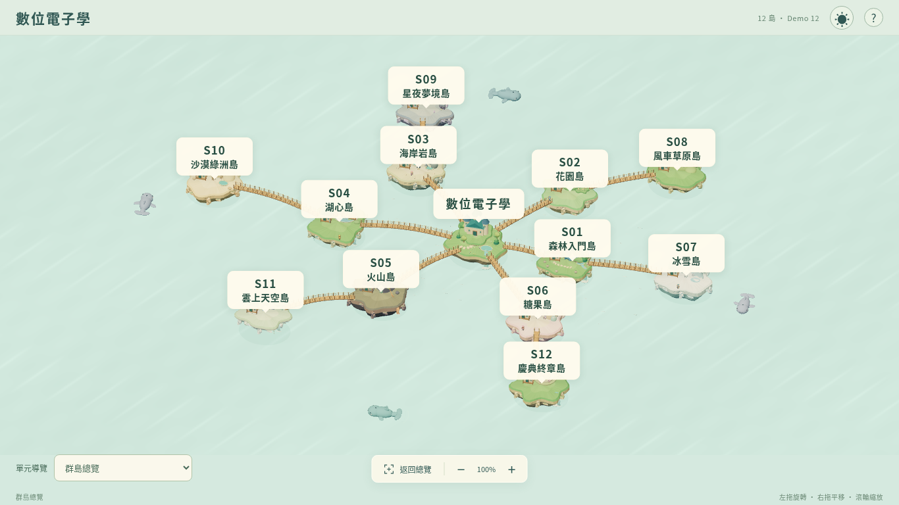
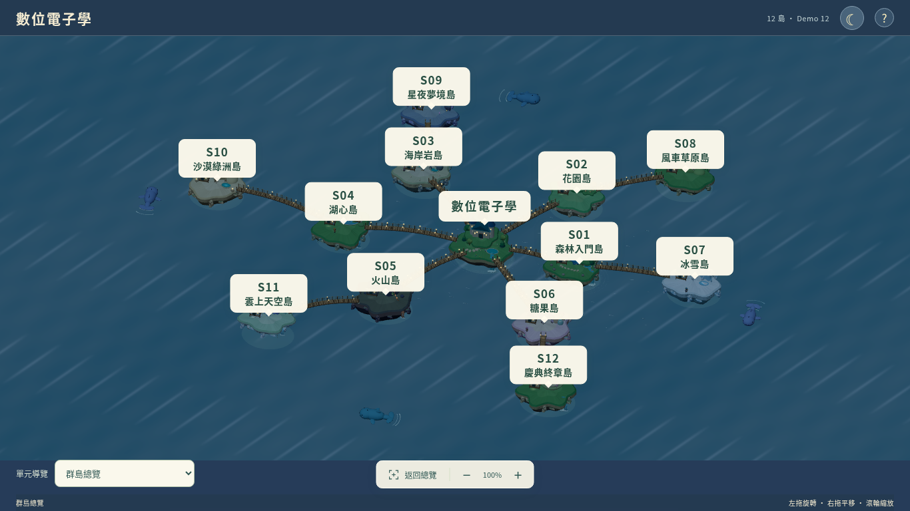
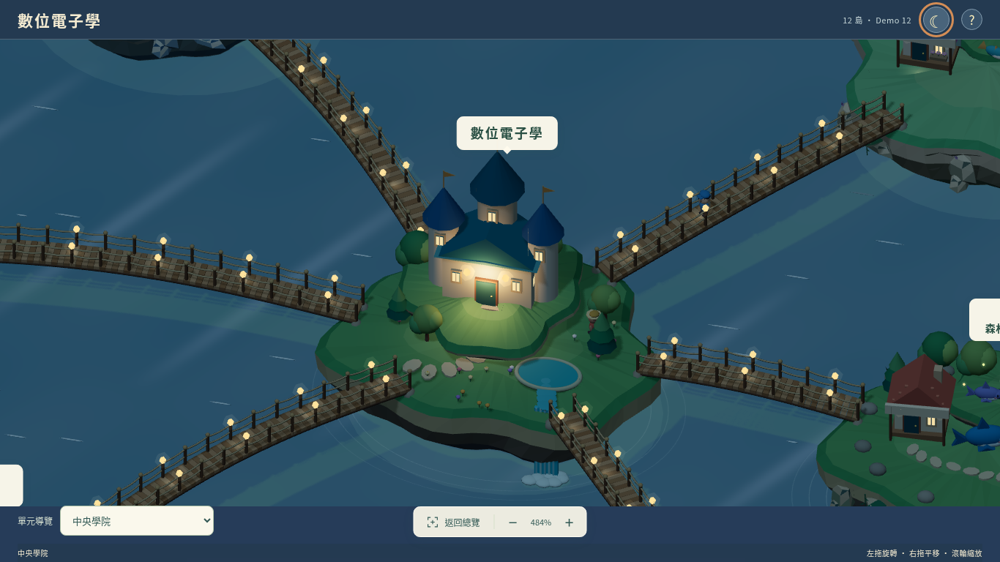
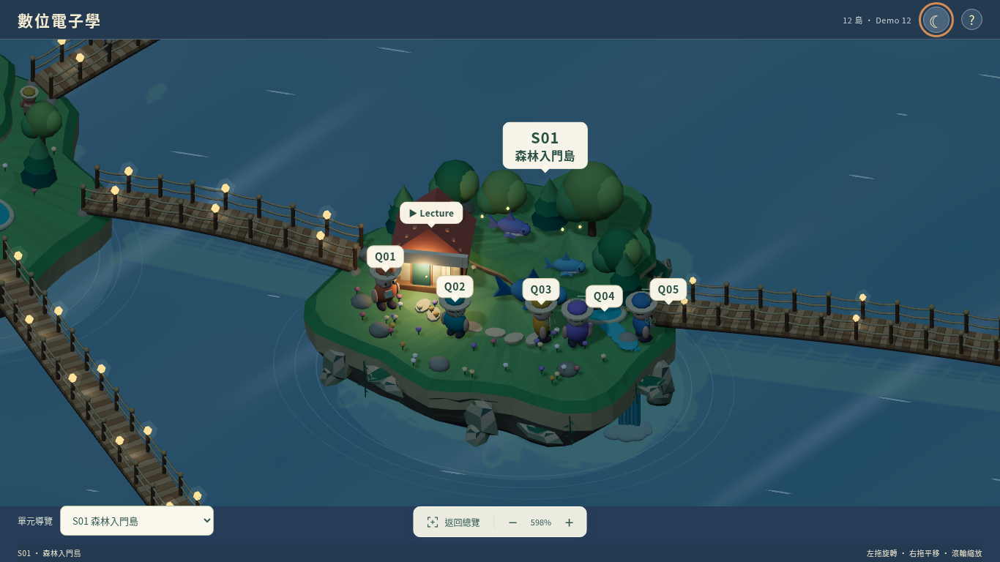
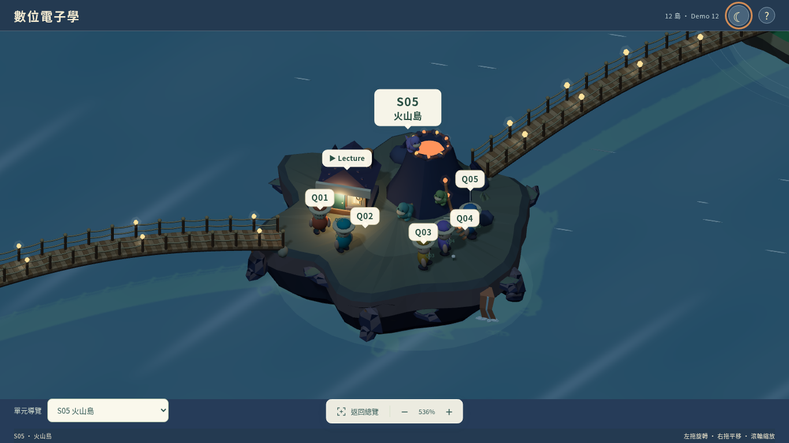
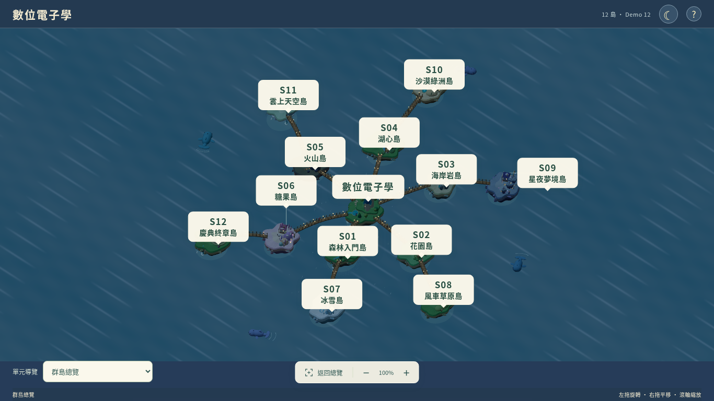
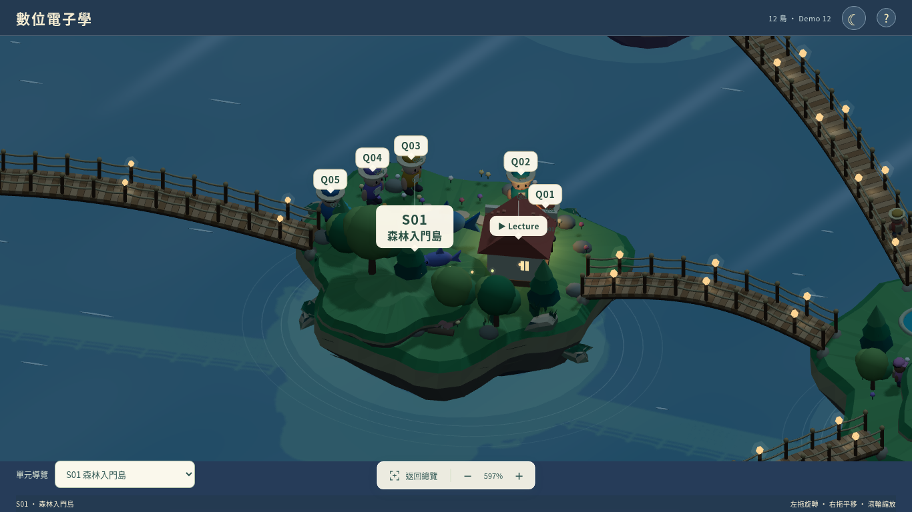
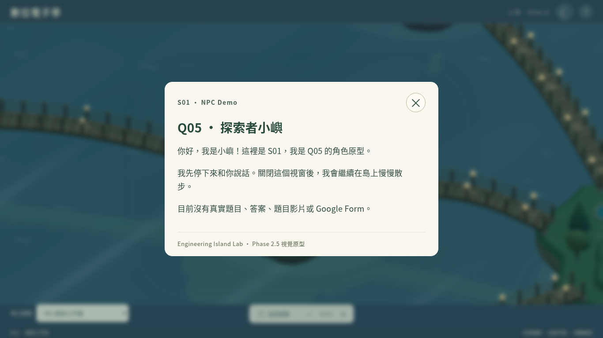

# Phase 2.5 — 日夜點燈與正交相機環繞驗收

日期：2026-10-30（台北）。基準 main `d136c9c`，PR #2 已合併，教師明確確認 Phase 2 Windows 11 Chrome／Edge 驗收。新分支 `feature/phase-2-5-day-night-camera-orbit`；本輪交付唯一新 Draft PR，停止等待教師驗收，不合併、部署、Tag／Release 或進 Phase 3。

完整授權：[PHASE_2_5_BRIEF](PHASE_2_5_BRIEF.md)。參考教師提供的日夜畫面中冷海／暖窗／橋燈對比，只用程式原創幾何與材質，沒有複製網站模型或程式。

## 完成的日夜系統

- 右上太陽／月亮小按鈕，aria-label／aria-pressed 隨狀態更新，可 Tab、Enter、Space 操作。預設 Day，重載回 Day，不存偏好、不自動循環。
- 1.25 秒 smoothstep 過渡，過程可反向切換，世界不重建。相機與 NPC／動物／鯨魚／旅人持續更新。
- Day 精確還原原 HemisphereLight（1.8）、DirectionalLight（2.4）、天空及薄荷海色。原 ACES exposure 1.05、sRGB 輸出與聚焦陰影策略不變。
- Night 天空 #172d48、海面 #264e67；冷色環境0.68、月光0.48，保留地形與角色輪廓；原海流與間歇噴水不中斷。
- 學院9扇窗及2個入口燈；15座 Lecture 小屋各4面窗、2門燈，從背面環繞也有窗光。窗光為獨立 Emissive Mesh，未改共享／合批材質。
- 全部木橋有疏密適當的暖燈，六條學院主幹共56燈；用實際橋曲線與柱位置定位，不改橋面、地貌或通行網。
- 15主題效果共用同一套窗光、燈芯、低透明光暈、柔和地面光斑及晶體元件；森林螢火蟲、花園小燈、海岸燈塔、湖光、火山熔岩、糖果燈、冰晶、風車燈、星光花草、營地燈、雲光、節慶燈、竹燈、四色晶礦及珊瑚螢光。

最多六個 InstancedMesh 批次／13,664 triangles；Day 全部隱藏而不增加燈飾 draw calls。沒有 Bloom；至多一個無陰影 PointLight 跟隨聚焦小屋或學院，總覽關閉。燈飾根在 island framing／CPU導航／拾取計算後才建立；資源以 controller.dispose → world.dispose 釋放，測試確認只釋放一次。

## 相機與操作

保留單一 OrthographicCamera，延伸原 CameraRig target／goal／zoom／focus／reset，不引入第二套控制器。相機使用 azimuth／elevation 與指數平滑，世界本身不旋轉。水平方向可連續多圈；仰角限制25°–70°，初始仍為原 offset(8,31,34)方向、約41.6°。

| 操作 | 結果 |
|---|---|
| 左鍵單擊 | 島嶼、Lecture、NPC選取 |
| 左鍵拖曳 | 環繞相機 |
| 右鍵拖曳 | 平移 |
| Shift＋左鍵拖曳 | 平移 |
| 滾輪／工具列＋－ | 縮放 |
| 單指觸控拖曳 | 沿用平移 |
| 返回總覽／Canvas Home、Esc | 平滑回群島中心、標準方向及完整取景 |

逐畫面投影實際 framingPoints，依當下角度重算正交可見範圍；1／12／15島、桌面與窄視窗都涵蓋中間旋轉角度。相機距離與far依世界尺寸、可見半高及仰角調整，沿相同觀察軸退後，不改正交畫面XY構圖；避免外圍島或窄畫面海面落在近／遠裁切之外。背景海面延展為2048寬的單一平面，仍只有兩個三角形；消除窄畫面明顯邊界，不改島嶼或鯨魚路線。聚焦換島保留方向，手動縮放倍率在角度更新後仍保留；返回總覽沿最近等價標準方向復位，避免多圈倒轉。

6px 最大移動距離區分 click／drag，拖出去再回原點也不觸發選取。CSS2D 按鈕亦追蹤最大位移，標牌手勢不穿透地圖。多指／pointercancel／capture loss 不誤點，取消後的新手勢可恢復。document捕獲階段也取消跨Canvas／CSS2D的第二指，避免兩個事件擁有者漏接多指；後續單指及鍵盤仍可操作。延用原島名避讓與引線，聚焦時先保留Q標，再安排Lecture與島名；避免背面視角島名蓋住NPC。頭頂Q標仍隨NPC原錨點移動，必要偏移以細線連回，原跟隨測試同步驗證錨點加位移。背面可能有原建築／樹木遮住模型，仍可操作朝向螢幕的 CSS2D 標牌。

Modal 開啟時停止 CameraRig easing，並封鎖旋轉／平移／縮放；原生 dialog 只捲動內容，保留620px／桌面28／18px、窄畫面16px和44px關閉鈕。背景生命及日夜動畫繼續，題目 NPC 的 pause／resume 與 Esc／關閉／焦點回復不變。

## 實際平行分工與整合

先凍結 [PHASE_2_5_INTERFACES](PHASE_2_5_INTERFACES.md)，實際使用 spawn_agent 平行執行，兩者均已交付並停止編輯：

| 負責人 | 唯一檔案範圍 | 實際交付 |
|---|---|---|
| A `/root/phase25_lighting` | world/day-night.js、world/sea-life.js、test/day-night.test.js | 光照／天空／海色過渡、窗光／橋燈／15主題、局部光、8項新增測試；與原海面7項一起15/15通過 |
| B `/root/phase25_orbit` | camera.js、interaction.js、test/orbit.test.js | Orbit／fit／focus／reset、左右與Shift手勢、觸控／取消、12項新增測試通過；亦驗原相機／場景回歸 |
| Main | main.js、ui.js、style.css、index.html、瀏覽器／效能腳本、文件、Git／PR | 審查兩者，整合UI與Modal、標牌拖曳隔離、背面互動、真實瀏覽器、效能與交付 |

Subagents 沒有修改共享核心、設定、教材、Git或各自建立PR。Main 審查發現多指取消後可能殘留 pointer ID，請 B 補復原測試並修正後才接受；另由 Main 在整合後補跨標牌／畫布的取消接線與 cancel 回傳介面。光照舊 sea snapshot 契約保持原樣，夜間色改由 lighting snapshot 診斷。

## 自動化測試

基準 Phase2：91/91及build通過。本輪執行 npm test、npm run build、npm run test:smoke、npm run test:browser。最終結果：**112/112單元、build、Apache smoke及56/56完整瀏覽器全部通過**，零應用JS／Console error。原始[命令輸出](acceptance/phase-2-5/verification.txt)、[相機／燈飾診斷](acceptance/phase-2-5/audit.json)已保存。主JS約719kB／gzip200kB，保留原Three.js >500kB提示。

新增單元測試21項（光照8、相機／互動12、Main海面覆蓋1），覆蓋精確Day復原、15小屋／六主橋／各主題、模式與拾取獨立、原鯨魚週期、資源釋放、1／12／15逐角度及仰角界限、中間影格fit、連續多圈、縮放／聚焦／復位、真射線與mock指標、多指取消與後續復原。

瀏覽器保留全部44項Phase2回歸，新增日夜、不同角度fit與實際手勢、背面NPC模型／全部Q編號標牌、Modal相機凍結、標牌拖回原點、雙模式、GPU資源穩定及CDP真觸控。正式Manifest仍為空，production忽略全部Demo query，不新增課程影片／題庫請求。

## 原始瀏覽器截圖

以下均為真實 Chromium／WebGL 截圖，無AI生成或後製。Day／Night總覽保持相同相機位置、角度、縮放與1366×768視窗；生命動畫持續，因此角色位置可能不同。










另附[15島夜景](acceptance/phase-2-5/overview-15-night.png)、[晶礦](acceptance/phase-2-5/crystal-night.png)、[Video-only](acceptance/phase-2-5/video-only-night.png)及[390px](acceptance/phase-2-5/narrow-night.png)；原始診斷保留在同資料夾。

## 效能比較

使用同一支 scripts/phase25-performance.js，Phase2根目錄為 main d136c9c 的獨立唯讀副本。相同 Chromium／1366×768／DPR1、open6、questions5；Quiz有30NPC、Video-only為0，5旅人、4鯨魚，每島三動物。各情境暖機後取30個RAF間隔，calls／triangles報該段最大值。旋轉樣本為實際mouse按下後每影格連續pointermove；Phase2原本無orbit，該欄不做虛構比較。

Linux headless Chromium **154.0.8037.57**，ANGLE Vulkan **SwiftShader Device (Subzero) 軟體GPU**。基準在平行工作停止後補測，兩版本量測均未同時執行其他GPU預覽。每格為 **FPS / draw calls / triangles**：

| 模式／情境 | Phase2 Day | Phase2.5 Day | Phase2.5 Night |
|---|---:|---:|---:|
| Quiz／12島總覽 | 3.76 / 296 / 272,670 | 3.22 / 296 / 272,670 | 3.67 / 302 / 283,886 |
| Quiz／15島總覽 | 3.01 / 362 / 347,494 | 3.08 / 362 / 347,494 | 2.94 / 368 / 361,158 |
| Quiz／S01聚焦 | 3.85 / 139 / 129,330 | 4.12 / 139 / 129,330 | 3.65 / 133 / 138,606 |
| Quiz／火山聚焦 | 5.54 / 122 / 104,151 | 5.28 / 122 / 104,151 | 4.99 / 127 / 115,327 |
| Quiz／12島連續旋轉 | —（原版不支援Orbit） | 3.85 / 296 / 272,670 | 3.40 / 302 / 283,886 |
| Video-only／12島總覽 | 3.87 / 296 / 272,670 | 3.81 / 296 / 272,670 | 3.61 / 302 / 283,886 |
| Video-only／15島總覽 | 3.06 / 362 / 347,494 | 3.16 / 362 / 347,494 | 2.95 / 368 / 361,158 |

14個本輪樣本約2.94–5.28 FPS。白天12／15總覽的296／362 calls、272,670／347,494 triangles與main相同；夜間為302／368 calls、283,886／361,158 triangles，增加6批及11,216／13,664 triangles。聚焦或旋轉時因視錐與持續活動的旅人／動物，各批可見性不同，不將較少calls或短樣本FPS升降解讀為效能改善。

原始[main六個基準](acceptance/phase-2-5/baseline.json)及[本輪十四個樣本](acceptance/phase-2-5/performance.json)含viewport、DPR、renderer、數量、幾何與貼圖資訊。本環境沒有可報告的實體GPU數據；不能視為Windows硬體GPU驗收。Phase2教師通過是定性確認，未提供數值；Phase2.5仍需教師Windows驗收。

## Windows 11 Chrome／Edge 本機再驗收

```powershell
git fetch origin
git switch feature/phase-2-5-day-night-camera-orbit
git pull --ff-only origin feature/phase-2-5-day-night-camera-orbit
npm ci
npm test
npm run build
npm run demo
```

瀏覽 http://localhost:5173/?demo=1&units=12&open=12&questions=5 ，再改units=15與mode=video-only。兩款瀏覽器以100%縮放、1366×768、1920×1080及390px驗收：

1. 比較同視角Day／Night，夜晚有清楚窗光／六主橋燈／主題發光，NPC、動物、鯨魚仍可辨識。連續切換、過渡中轉向及重載回Day。
2. 左拖連續環繞，試90／180／270／360度及上下限；右拖和Shift左拖平移、滾輪縮放，不誤開視窗。返回總覽恢復標準方向且不漏島。
3. 聚焦S01、S05、S14，繞至背面、換島保留角度。點可見NPC模型與Q01–Q05頭標，確認正確編號、停止／恢復；小屋仍可用。
4. Modal開啟後試所有相機手勢及滾輪，只捲內容；Esc、關閉鈕與焦點正常，背景生命持續。
5. 切Video-only，不見題目NPC／Q標；動物、旅人、燈飾保留。以open=4驗鎖牌／柵欄；預設正式空Manifest全部鎖定，沒有正式教材。
6. 記錄chrome://gpu或edge://gpu的實際renderer，重跑 npm run test:browser 與 node scripts/phase25-performance.js。可用CHROMIUM_PATH指定已安裝Chrome／Edge；從test-results讀原始GPU/FPS/calls/triangles，不能將SwiftShader當硬體GPU。

## 已知限制與停止點

本階段沒有雙指縮放、真流體、Bloom或逐燈陰影。既有六個不安全橋口仍不供背景旅人通行，詳見Phase2場景報告；本輪未改路網或地貌。正式Lecture影片、Quiz判答／解說／Form及後端未實作。建置仍可能提示Three.js主chunk大於500kB。

完成後只交付新Draft PR，等待教師Windows驗收；不合併、不部署、不Tag／Release、不進Phase3。
