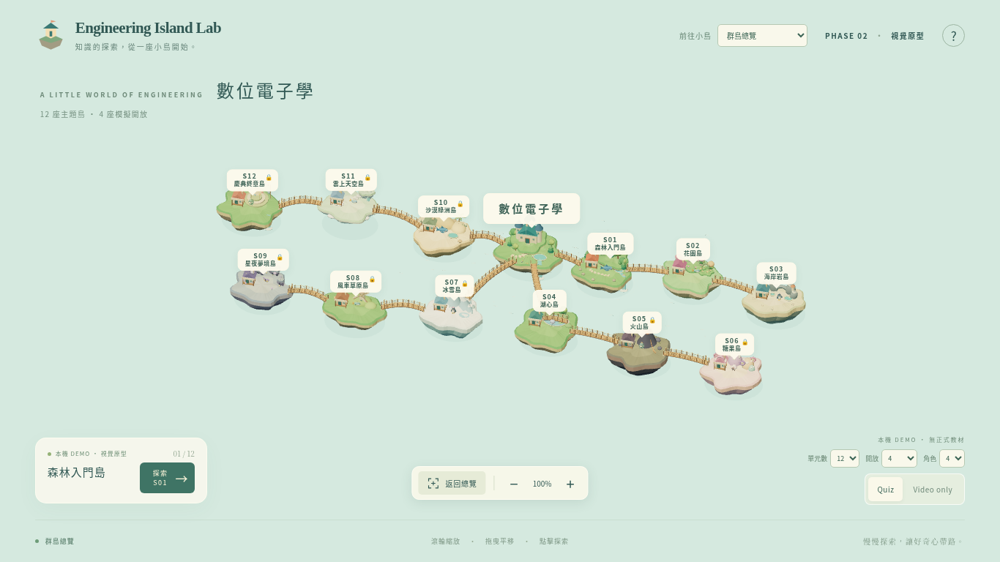
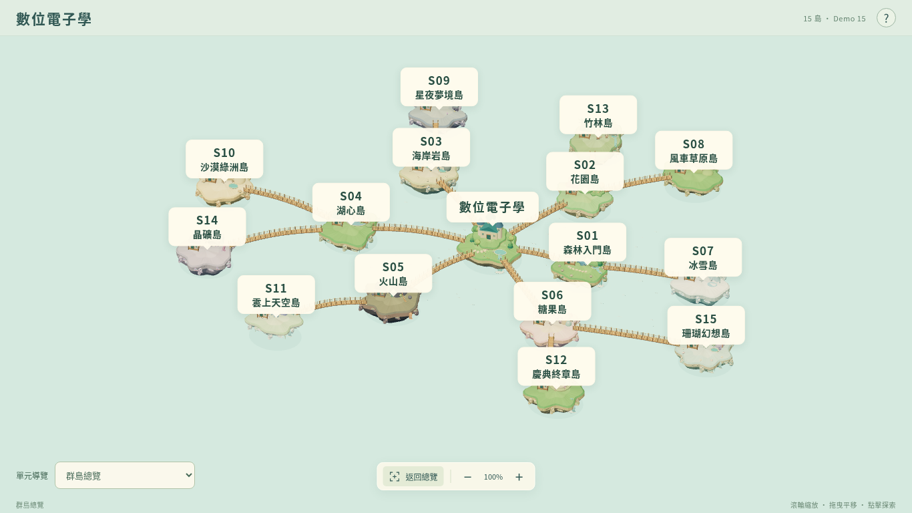
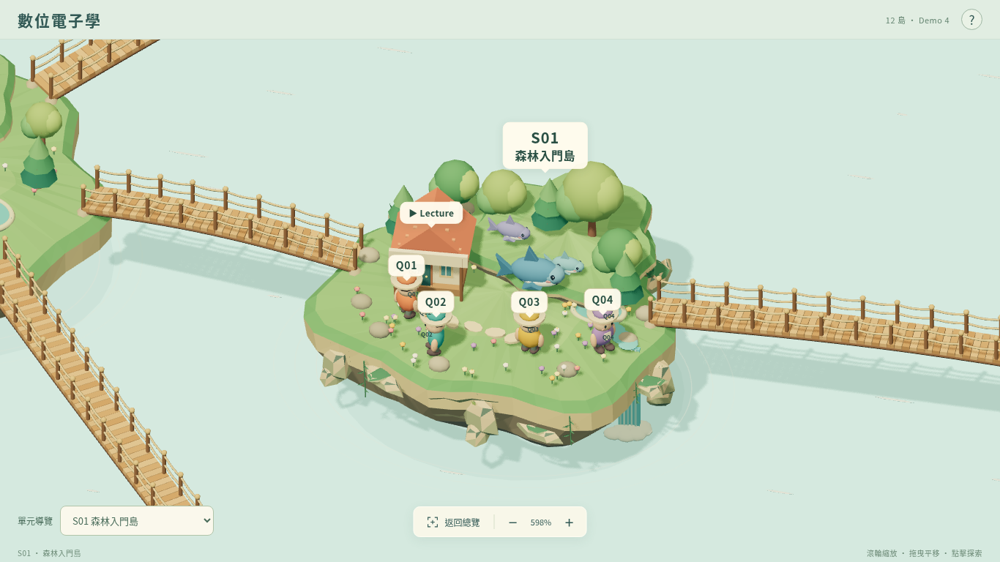
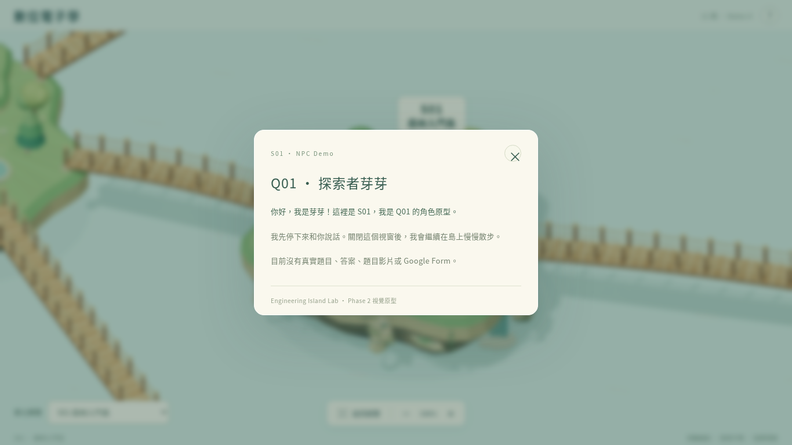
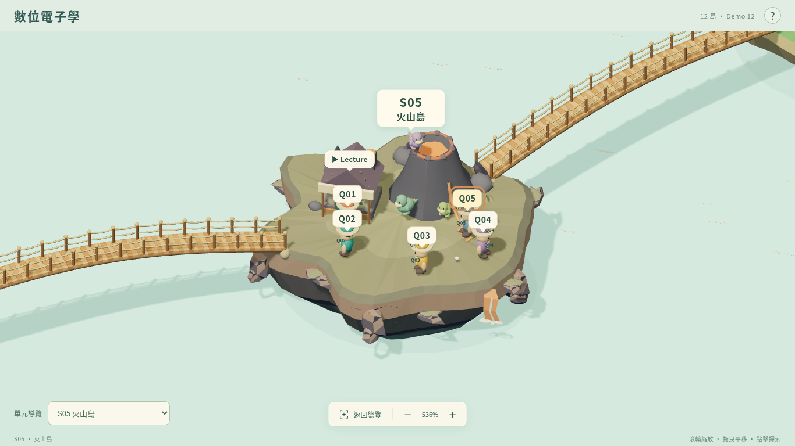
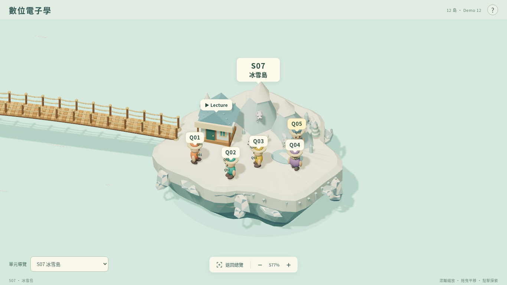
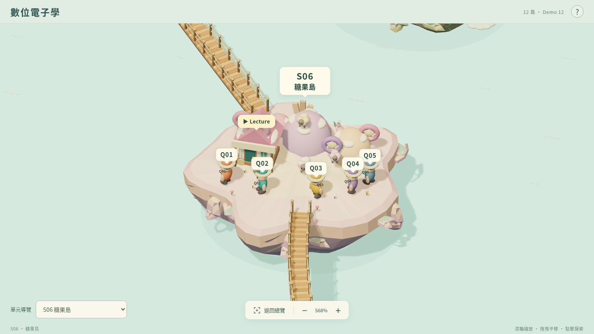
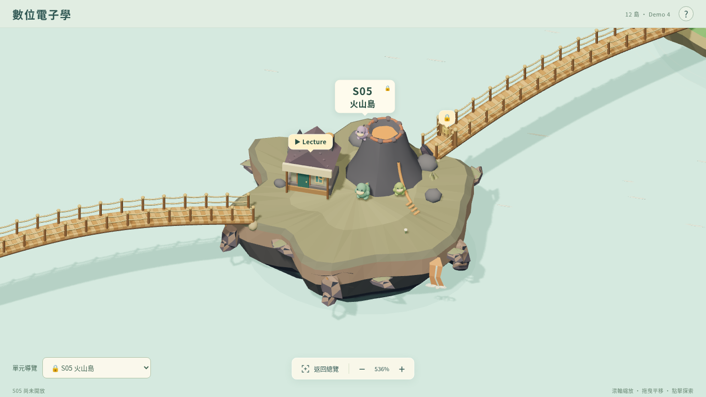
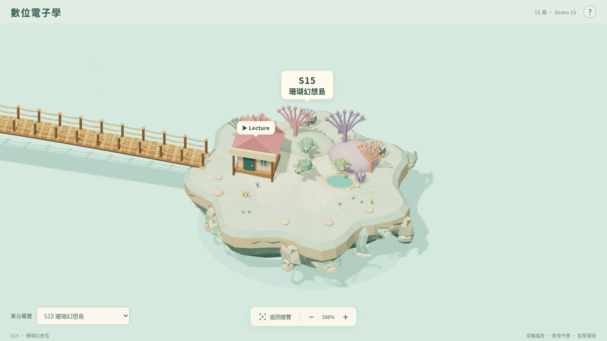

# Phase 2 — 教師驗收修正與再驗收

日期：2026-10-29。沿用 `feature/phase-2-full-archipelago` 與 [Draft PR #2](https://github.com/chingchechung/engineering-island-lab/pull/2)，修正基準為 `978be95`；main 基準仍為已驗收的 `3e5c883`。Phase 0／1 含木橋已合併且經教師 Windows 11 驗收。**本輪修正完成自動化驗證，仍等待 Windows 11 的視覺、操作與硬體效能再驗收。**

教師原文：[Phase 2 指示](PHASE_2_BRIEF.md)、[本輪八項修正](PHASE_2_REVISION_BRIEF.md)。沒有修改正式網站、題庫、Manifest、套件或 lockfile，也沒有開始 Phase 3／4。

## 八項修正結果

| 要求 | 最終行為及驗證 |
|---|---|
| 大字島名 | 桌面總覽編號 17px／中文 14px，聚焦 20px／16px；手機 15px／12px，聚焦 18px／14px。以實際文字矩形避讓，必要時加細引線，不縮成小字；12／15／390px 檢查無重疊或裁切。 |
| 更豐富裝飾 | 15 主題增加多層岩肩、崖壁、凸岩、藤、靜態瀑布／浪花與各島植被／道具。新增 816 組特徵／實例，其中 540 個實例分 43 組 InstancedMesh，新增約 34,766 triangles。保留 NPC 漫遊與動物清空區、小屋正面及橋口。Quiz／Video-only 裝飾相同。 |
| NPC 漫遊 | 每人半徑 1.05、速度約 0.22–0.28 單位／秒，走動、等待、轉身及肢體動畫。依地表高度、坡度、水面、建物、視線與同伴距離選安全路段；頭標跟隨，衣帽編號保留。模型或頭標點擊立即 `setNpcPaused`，關閉 Modal 恢復，無追趕跳位。 |
| 單列頂部 | 唯一 h1 與頁籤從 `courseTitle` 載入；移除品牌列、第二課名及副標空白。另以「電路設計工作坊」設定攔截測試，確認不是寫死。1366×768 畫布由 453 增至 638px，增加 185px（約 40.8%）。 |
| 唯一左下導覽 | 原生下拉選單由 `totalUnits` 產生總覽／學院／Sxx。選島平滑聚焦；模型、標籤與選單同步。鎖定島可欣賞，內容仍阻擋。舊探索卡與右上選單移除。 |
| 移除 Demo 面板 | 一般畫面無模式／數量／開放控制。只有 Vite dev＋明確 `demo=1` 接受受控 query；production 忽略全部覆寫，仍以 JSON 設定與正式 Manifest 為準。 |
| 放射布局 | `layout.js` 將主題與座標分離；中央學院連 S01–S06 六主幹，其餘為一層短支線，學院至單元最多兩跳。所有 1–15 前綴連通；另檢查實際弧橋分段不交叉、含橋寬的取樣不穿過其他島體，橋端用真實地表射線落岸。保留木橋弧線與 S01 原模型，僅移動群島座標。 |
| 每島三動物 | 12 島 36 隻、15 島 45 隻；15 種代表物種互不重複，各個體體型／色彩／相位不同。S01 第一隻使用原物件、幾何及原跳鯊 pose；鎖定／Video-only 全部保留，不註冊任何互動。 |

完整主題與物種表見 [README](../README.md#島嶼與三隻代表動物)：鯊魚、熱帶魚、企鵝、水母、恐龍、羊、北極狐、鴨、蝴蝶、駱駝、鯨魚、紅鶴、熊貓、晶靈、海龜。

相機維持約 42° 的 OrthographicCamera，總覽改用每島實際投影角點及標牌取景，避免整個世界大 bbox 的空角浪費畫面；縮放上限 16。保留滾輪、拖曳、點島聚焦、返回、Modal 隔離與鍵盤操作。橋純視覺，不加入學生化身、角色通行、碰撞或尋路。

## 真的平行執行與檔案所有權

初版 Phase 2 曾先凍結 [Island Factory](ISLAND_FACTORY.md)，透過四組 Subagents 交付 nature（S02–S04）、fantasy（S05–S08）、dream（S09–S12）、extended（S13–S15），主 Agent 統一整合。初版紀錄／截圖與數據保留在 `acceptance/phase-2/`。

本輪再次先建立 [修正介面與所有權](REVISION_INTERFACES.md)，**實際透過 `spawn_agent` 啟動三位 Subagents**，不是僅列文字工作分配：

| Agent | 唯一擁有的程式／測試 | 實際交付與主 Agent 審查 |
|---|---|---|
| A `/root/revision_dressing` | `src/world/dressing.js`、`test/dressing.test.js` | 15 島靜態主題裝飾與 placements；4 項測試，有限幾何、保留區、兩模式一致、合批與冪等。已審查整合後主題近景。 |
| B `/root/revision_npc` | `src/world/npc-motion.js`、`test/npc-motion.test.js` | 純控制器的固定步進、局部關節、半徑／路段／同伴安全、pause/resume；10 項測試。主 Agent 接地表安全與 Modal，另驗全部 75 人。 |
| C `/root/revision_fauna` | `src/world/fauna.js`、`test/fauna.test.js` | 45 個獨立個體、15 物種、原 S01 保留、錯相與可動關節；6 項測試含 360 次取樣視線、合批、資源釋放。已審查整合截圖。 |

三者均已實際交付並停止編輯，未改共享核心、package／lock、AGENTS／Plan、其他測試或 Git／PR。主 Agent 同步負責放射布局、橋、介面、標籤、場景整合及瀏覽器回歸；沒有讓 Subagents 自行建 PR。

介面：

- 島工廠保留 `{root,terrain,house,top,landmarks,animate,creatures}`，幾何為島內局部座標。
- 裝飾 `addIslandDressing(record)` 回傳 `{group,count,placements}`，在場景合批前掛入 root。
- 動物 `createIslandFauna(record)` 回傳恰好三個 `{group,kind,update(seconds)}`，只依絕對時間動畫，根標記 `animated`／`decoration`。
- NPC `createNpcMotion(npc,{center,radius,seed,isSafe,heightAt,peers})` 回傳 `update(seconds)`、`setPaused(bool)`、`getState()`。場景暴露 `setNpcPaused(unitId,questionId,bool)`，可供未來正式 Quiz 沿用。
- NPC 與活動關節標記 `animated`，靜態世界合批跳過；它們只在各自局部框架內合批。合批後 Raycasting／標籤／移動仍保留。

主 Agent 的 `npc-safety.js` 在合批前凍結 CPU 射線地表與障礙參照，使用平滑高度快取與視線檢查。測試曾找出量化高度的階梯造成部分 NPC 無法走動，已改成雙線性高度取樣；最終 75 人都在安全圈內實際移動。這是視覺漫遊的局部安全判斷，沒有引入完整導航或物理系統。

## 自動化驗證

| 命令 | 本輪最終結果 |
|---|---|
| `npm test` | 68/68 通過；保留原 41 項，新增 27 項。包括 1–15 拓樸、12／15／窄畫面取景、字標避讓、dev 參數隔離、裝飾／動物、固定步進與 75 人安全漫遊／間距／局部合批／暫停。 |
| `npm run build` | 通過；37 modules，主 JS 680.73kB／gzip 186.19kB。既有 Three.js >500kB 提示仍存在。 |
| `npm run test:smoke` | 通過；重建後模擬 Apache `/~wildwolf/engineering-island-lab/`，HTML／JS／CSS／favicon／JSON／空 Manifest。 |
| `npm run test:browser` | 24/24 通過；原 12 項操作回歸＋12 項完整群島／修訂驗收。Linux Chromium 154、實際 WebGL 與 DOM。 |

瀏覽器包含移動中 NPC 模型的實際滑鼠射線點擊、頭標跟隨與點擊、Modal 期間不移動及關閉後恢復；單一課名／導覽、可讀字級／標籤不重疊、全部動物與兩模式裝飾一致、五題／鎖定／柵欄、12／15／窄視窗、production 全部測試參數無效、零應用 JS／Console error。保留原 Lecture 占位、拖曳閾值、縮放、焦點回復與 Apache 子目錄檢查。

本環境的 HTTP 測試需開放 loopback 網路；首次無網路的 `npm test` 卡在原設定測試本機 server，已停止該次並以允許 loopback 的執行環境完成正式結果，沒有降低斷言。

## 效能量測與限制

共同幾何／材質、花草與批次小物使用 InstancedMesh；裝飾合批每島最多四個靜態材質 bucket。動態 NPC／動物根及關節不烘焙到世界。遠景更新 6Hz、近景逐畫面，保留 frustum culling、細節管理、聚焦陰影與 scene／instance／shadow 資源釋放。總覽以接觸陰影取代全群島 shadow map；未加重粒子、後製或大型外部模型。

**以下全部是軟體 GPU，不能當作 Windows 硬體 GPU 成績。** Linux headless Chromium `154.0.8037.57`、DPR=1、ANGLE／Vulkan SwiftShader Device (Subzero)。每情境暖機後量測 30 個真實 requestAnimationFrame 間隔，draw calls／triangles 取 renderer.info；這是短樣本，受環境負載影響。

各效能情境均為 Quiz、S01–S04 模擬開放、四題（總 16 位 NPC），其餘島鎖定；12／15 島分別有 36／45 隻動物。

| 情境 | FPS | Draw calls | Triangles |
|---|---:|---:|---:|
| 12 島總覽 1366×768 | 3.70 | 298 | 260,364 |
| 12 島 S01 聚焦 1366×768 | 4.28 | 124 | 118,136 |
| 15 島總覽 1366×768 | 1.53 | 364 | 335,188 |
| 15 島 S01 聚焦 1366×768 | 3.67 | 125 | 127,760 |
| 12 島總覽 1920×1080 | 2.09 | 298 | 260,364 |

本輪增加裝飾與三倍動物，且擴大畫布；軟體 GPU 仍不流暢。沒有取得 Windows Chrome／Edge 或實體 GPU 成績，**未宣稱已達一般筆電 30／60 FPS 或通過教師美術驗收**。先前版本數據只作歷史紀錄，不作相同負載的直接效能比較。

原始紀錄：[本輪 performance.json](acceptance/phase-2-revision/performance.json)、[初版 performance.json](acceptance/phase-2/performance.json)。Windows 可用 `CHROMIUM_PATH` 指定 Chrome／Edge 後執行 `npm run test:browser`，確認輸出 JSON 的 renderer 是實體 GPU；或在 dev Demo Console 執行 `window.__islandLab.snapshot()` 讀取 FPS／calls／triangles。production 不暴露 debug API。

## 代表性截圖

以下是整合版本自動化產生的原始畫面，未人工修圖。

### 12 島修正前後（同為 1366×768）

修正前：水平分支、小字、重複導覽與大型 Demo 面板。

修正後：六主幹放射網路、大字、單列課名及左下唯一導覽。

### 15 島總覽

### S01 漫遊與點擊暫停

### 主題裝飾、三動物與開放狀態

另提供 [1920×1080](acceptance/phase-2-revision/wide.png)、[390px 窄視窗](acceptance/phase-2-revision/narrow.png)、[竹林](acceptance/phase-2-revision/S13.png)、[晶礦](acceptance/phase-2-revision/S14.png)、[珊瑚](acceptance/phase-2-revision/S15.png)。

## Windows 再驗收與停止點

依 [README 的 Windows 步驟與十二項清單](../README.md#windows-11-chromeedge-本機驗收)，在 Chrome／Edge 重看 12／15 島總覽、名稱、放射橋網與實際岸端，近看裝飾／三動物，分別點漫遊模型與頭標，確認暫停／恢復、導覽同步、Modal、兩模式、鎖定與實機流暢度。

正式 JSON／Manifest 仍維持原樣，未載入正式 Lecture／題庫、不判答、不開 Form。觸控保留基本單指平移及多指取消，尚無雙指縮放；正式 Lecture／Quiz 與完整教材發布工具仍待後續授權。

本輪只更新原 Draft PR #2，完成後停止。**教師 Windows 再驗收仍未完成；不自行 Merge、Tag、Release、部署或進入 Phase 3。**
