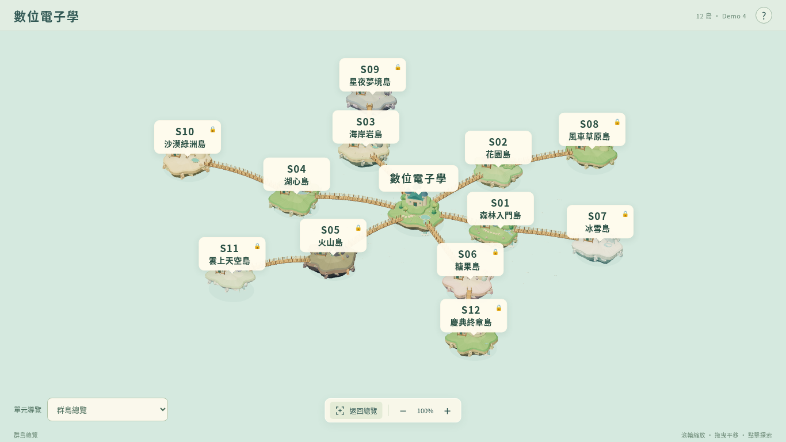
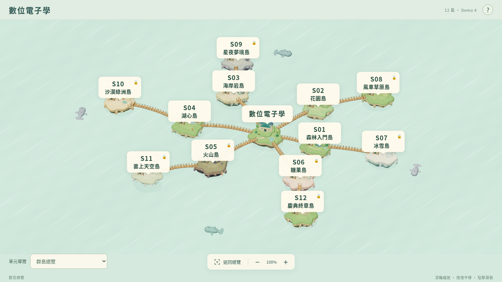
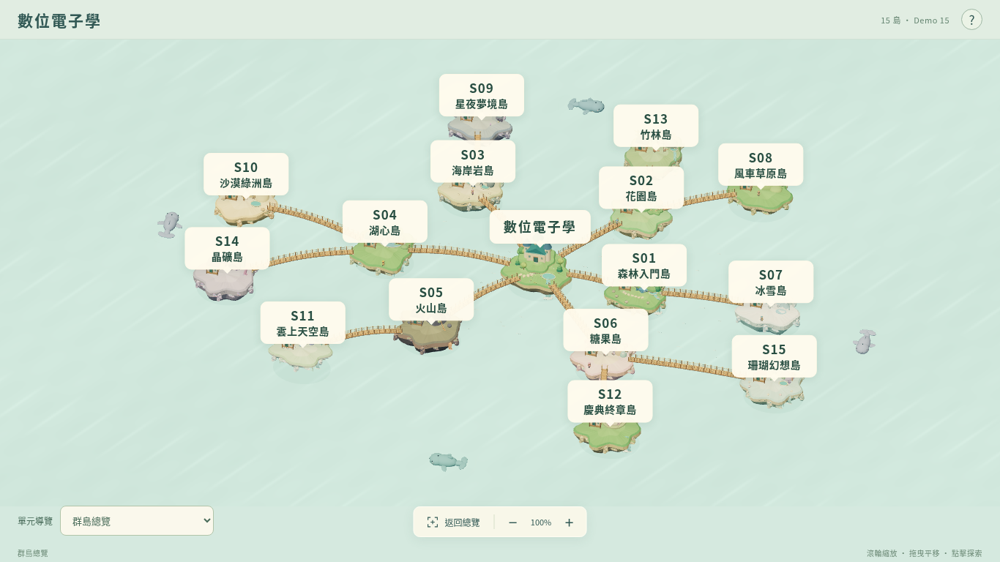
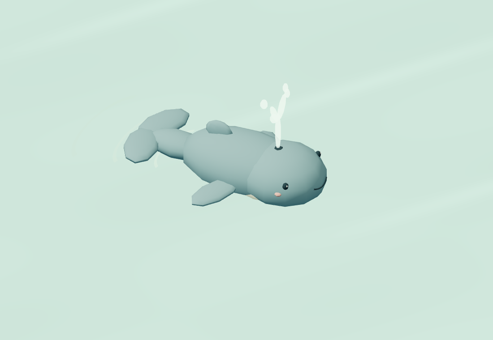
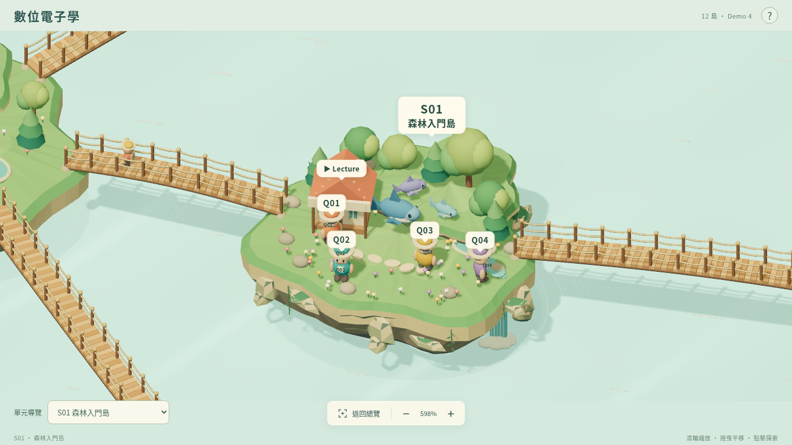
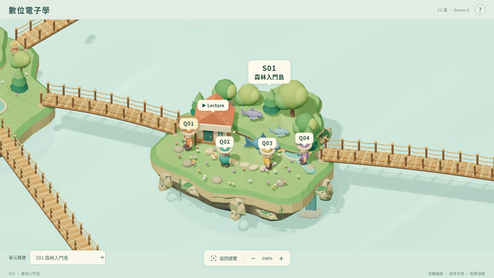
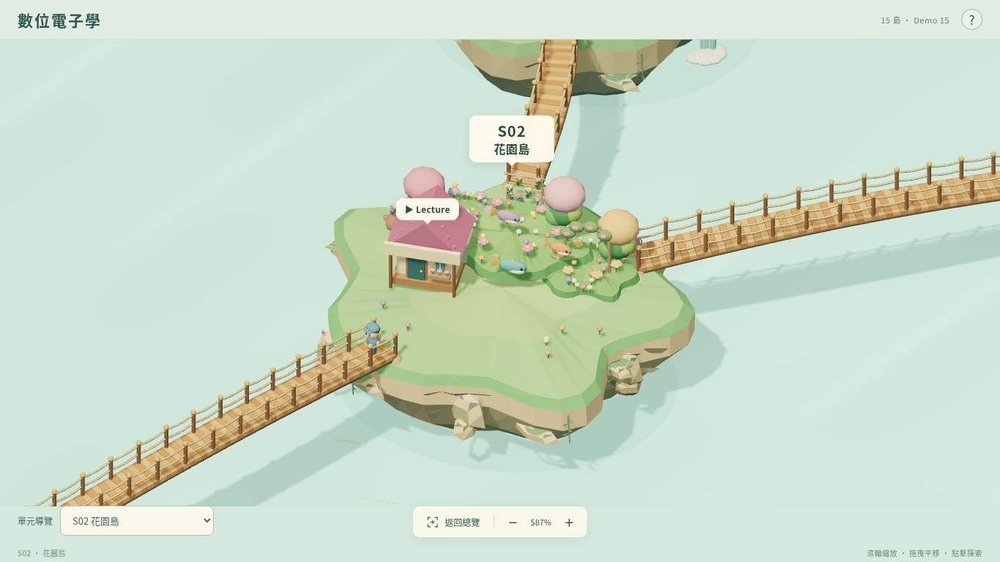

# Phase 2 — 最後一輪場景生命感驗收

日期：2026-10-29（台北）。沿用 `feature/phase-2-full-archipelago` 與 [Draft PR #2](https://github.com/chingchechung/engineering-island-lab/pull/2)，本輪基準 `25f2c62`，main 仍為 `3e5c883`。

教師已明確確認前版的 Windows 11 島名標籤、題目 NPC 漫遊／點擊停止，以及 12／15 島硬體 GPU 流暢。本輪新增海面／外海鯨魚／背景小旅人，完成下述自動化與視覺檢查後，**仍停止等待教師再次驗收新增項目**。沒有取得前版或本輪的 Windows 數值 FPS。

範圍見 [本輪授權](PHASE_2_LIFE_BRIEF.md)。前版八項修正、15 主題與原測試紀錄保存於 [前版驗收報告](PHASE_2_REVISION_ACCEPTANCE.md)；正式 JSON、Manifest、題庫／教材均未改，未進 Phase 3。

## 完成內容

### 海面與四隻外海鯨魚

- 一個薄荷色 ShaderMaterial 平面，以時間 uniform 緩慢漂移波紋及亮面；在原透明海面陰影接收層下方，不影響島／橋陰影，沒有外部貼圖、流體、後製或粒子引擎。
- 四隻大型、圓潤、原創 Low-Poly 鯨魚，各有不同色彩／比例／擺動相位，擺鰭、甩尾並沿整個群島外框巡遊。
- 圓角外框路線距原群島 Box3 為 6.52 單位，包含最大動態包絡 4.62 與至少 1.9 的安全距離；測試取樣了活動關節的全部頂點，確保鯨魚不進島間水道或橋網。
- 每隻輪流間歇噴水，四隻錯相；簡化為合計 28 個水柱／水滴實例與 12 個尾波實例。整套海面／鯨魚最多 19 draws、8,866 triangles，不投射陰影。
- 海面與鯨魚完全不註冊 action、hover、事件或 Q 標。點鯨魚不開視窗、不切焦點，Modal 開啟時仍自主活動。

### 已開放島嶼的背景小旅人

- `visitors` 是獨立環境系統，沒有與題目 NPC 共用狀態、標籤或點擊。戴帽、背包及無編號衣服，總高約 1.1 單位，約為題目 NPC 的三分之二。
- 正式／Demo 的開放結果決定數量：0 開放為 0 人；否則 `min(8, 3 + floor(openCount/3))`。開 1／4／12／15 島分別為 3／4／7／8 人，與 Quiz／Video-only 無關。
- 只在已開放單元島生成及停留，中央學院作跨島中轉。依實際地表分區和開放橋口建立 BFS 路網；到達另一開放島後走動、停留，之後選下一站並定期返回原島。
- 地表路點為 0.36 單位網格，使用原地形三角面高度與障礙取樣；不斜切建築／池塘轉角。每個移動小步再次檢查安全，橋上精確沿既有弧線中央行走，橋岸小高度差平滑銜接，不在海面抄近路。
- 反向來客在岸上等候，橋內單向排隊，同向保持間距；遇題目 NPC 或其他小旅人等待／繞讓，只移動旅人，從不修改題目 NPC 的位置或 pause/resume。
- 畫面上的小旅人無法被點擊、控制或暫停。下方島體仍可正常被點擊聚焦，背景角色不攔截原互動。

### 可通行橋口的界線

背景路網以**真實可安全進出的橋口與地表分區**為準。現有六個橋口被岩坡／水景／地物或岸端高度限制，因此不納入小旅人的跨島路線；橋模型保持完整，這些島仍可供旅人在安全地表漫遊。沒有為了背景通行重製已驗收地形。

| 未納入背景通行的既有連線 | 原因 |
|---|---|
| 學院 → S03 | 學院岸面約 1.90、橋面約 1.07，高差過大 |
| 學院 → S05 | S05 登岸處有既有地物阻擋 |
| S01 → S07 | S01 出橋岸邊有既有地物阻擋 |
| S03 → S09 | S03 出橋岸邊有既有地物阻擋 |
| S05 → S11 | S11 岸面約 3.87、橋面約 2.24，高差過大 |
| S06 → S12 | S12 岸端安全邊界／障礙限制 |

其餘安全連線可跨島，例如 S01／S02／S06 經學院東側、S04／S10／S14 經西側；支線也可通往風車、竹林、珊瑚等連通目的地。學院內被水景分開的地表區域亦分別計算，不能穿水池假裝連通。鎖定父島絕不成為捷徑；孤立開放島只在島內走動。開發模式 `snapshot().visitorRoutes` 提供 enabled／reason 診斷。

## 平行開發與整合審查

先凍結 [LIFE_INTERFACES](LIFE_INTERFACES.md) 後實際使用 `spawn_agent` 平行兩組，均已交付並停止：

| Agent | 唯一檔案範圍 | 實際結果 |
|---|---|---|
| A `/root/sea_life` | `src/world/sea-life.js`、`test/sea-life.test.js` | 海面、四鯨魚、尾波／噴水；7 項測試含整體動態幾何安全距離、確定性、錯相、合批及釋放；獨立 WebGL 預覽零錯誤。 |
| B `/root/visitors` | `src/world/visitors.js`、`visitor-navigation.js`、`test/visitors.test.js` | 地表／橋網、生成／巡遊、會車／避讓與局部合批；11 項測試含跨多島及返回、220 秒會車／跟隨、1／12／15 真實地形、閉鎖父島與近／遠頻率。 |
| Main | 既有共享核心、測試、截圖、文件與唯一 PR | 審查實際模組後接入，檢查背景拾取排除、原 NPC 與模式、攝影機取景、GPU 釋放及最終瀏覽器。 |

工廠介面為 `createSeaLife({bounds,seaY,count})` 與 `createVisitors({academy,records,seed})`，都回傳獨立 root、絕對時間 update 及唯讀 snapshot；背景根掛在 scene 而非 islands。相機 bounds／framingPoints 先完成再加入生命感系統，保留已驗收的總覽／聚焦構圖。

小人及鯨魚的根與活動關節保持 animated，只在各自局部框架合批；海面 shader 亦不烘焙進靜態世界。原本 45 個靜態海泡沫保持原位置／材質外觀，合成一批以減少 44 個呼叫。遠景旅人／題目 NPC／動物 6Hz，近景逐畫面；四鯨魚與單一海面時間 uniform 持續更新，保留頁籤暫停和資源釋放。

## 測試結果

| 命令 | 最終結果 |
|---|---|
| `npm test` | **91/91 通過**，保留原 68 項並新增 23 項（海面 7、旅人 11、主整合 5）。 |
| `npm run build` | 通過；40 modules，主 JS 702.40kB／gzip 194.20kB；既有 Three.js >500kB 提示仍存在。 |
| `npm run test:smoke` | 通過；Apache 子目錄 HTML／JS／CSS／favicon／JSON／空 Manifest。 |
| `npm run test:browser` | **32/32 通過**；保留原 24 項，新增 8 項背景生命感驗收，零應用 JS／Console error。 |

保留全部 75 題目 NPC 的可見／實際射線測試、漫遊／頭標／點擊即停及 Modal 關閉恢復、4／5 題、每島三動物、未開放柵欄、Video-only 零題目 NPC、12／15／窄視窗、縮放／平移／聚焦／返回、production query 隔離及子目錄載入。

新增驗證包含海面與鯨魚隨時間變動、背景點擊無互動、旅人實際登橋、只有開放連線、空 Manifest 零旅人、15 島全開時 75 題目 NPC＋45 特色動物＋4 鯨魚＋8 旅人，以及 Video-only 保留背景系統。旅人跨島、返回、每一步地表安全、中央線與會車由長時間 CPU 測試驗證；瀏覽器另以真實 WebGL／滑鼠檢查。

## 效能：軟體 GPU

Linux headless Chromium 154.0.8037.57，DPR=1，ANGLE Vulkan **SwiftShader Device (Subzero) 軟體 GPU**。每情境暖機後量 30 個真實 requestAnimationFrame 間隔；calls／triangles 取 renderer.info。沒有同時跑其他 GPU 預覽。

相同設定：S01–S04 開放、每島四題、4 旅人、4 外海鯨魚；12／15 島分別 36／45 隻特色動物。Quiz 共 16 題目 NPC，Video-only 為 0。總覽隱藏題目 NPC 細節，因此兩模式的總覽 calls／triangles 相同。

| 模式 | 情境 | FPS | Draw calls | Triangles |
|---|---|---:|---:|---:|
| quiz | 15 島 總覽 / 1366x768 | 3.09 | 359 | 347,806 |
| quiz | 15 島 S01 聚焦 / 1366x768 | 4.28 | 125 | 134,510 |
| quiz | 12 島 總覽 / 1366x768 | 3.88 | 293 | 272,982 |
| quiz | 12 島 S01 聚焦 / 1366x768 | 4.24 | 124 | 124,886 |
| quiz | 12 島 總覽 / 1920x1080 | 2.94 | 293 | 272,982 |
| video-only | 12 島 總覽 / 1366x768 | 3.84 | 293 | 272,982 |
| video-only | 15 島 總覽 / 1366x768 | 3.08 | 359 | 347,806 |
| video-only | 15 島 S01 聚焦 / 1366x768 | 4.29 | 85 | 120,430 |

本環境的軟體 GPU 仍不流暢，短樣本受負載與相機可見物影響，不能外推硬體 FPS。相同總覽的呼叫數由前版 12／15 島 298／364 降至本輪 293／359；新增背景模型增加 triangles，舊海泡沫合批抵銷了部分成本。沒有用軟體樣本的 FPS 差異宣稱硬體加速改進。

原始八個樣本與 renderer／數量／視窗資訊：[performance.json](acceptance/phase-2-life/performance.json)。前版軟體資料保留於歷史報告。

## 效能：實體 GPU 與教師確認

教師已確認前版 Windows 11 Chrome／Edge 的 12／15 島在硬體 GPU 下流暢；這是教師實測的定性結果，未附數值 FPS／calls／triangles。本輪雲端僅取得上述 SwiftShader 資料，**沒有可報告的新增項目實體 GPU 數值**；海面／鯨魚／旅人加入後，仍需教師重驗。

可在 Windows 啟用硬體加速，使用 `CHROMIUM_PATH` 指定 Chrome／Edge 執行 `npm run test:browser`，讀取 `test-results/life-performance.json` 並確認 renderer；或 dev Demo Console 的 `window.__islandLab.snapshot()` 讀 FPS／drawCalls／triangles。production 不提供 debug API。

## 代表性截圖

以下為原始瀏覽器畫面，未人工修圖。整合套件產生全景、旅人與兩模式圖片；鯨魚元件近景另以同一工廠的獨立 WebGL 預覽呈現。

### 12 島新增生命感前後

### 15 島總覽

### 鯨魚元件與噴水

相同 sea-life 工廠的獨立 WebGL 元件近景；實際整合位置見上方兩張總覽。

### 小旅人跨橋、題目 NPC 保留

### Video-only

另提供 [1920×1080](acceptance/phase-2-life/wide.png)、[390px 窄畫面](acceptance/phase-2-life/narrow.png)、[鎖定柵欄](acceptance/phase-2-life/locked-gate.png)、[題目 NPC 暫停](acceptance/phase-2-life/npc-paused.png)。

## Windows 再驗收與停止點

[README](../README.md#windows-11-chromeedge-本機驗收) 有更新分支、安裝、測試、啟動網址與十五項檢查。新增重點：總覽看柔和海流／外海巡遊與間歇噴水，放大小旅人辨識無 Q 標，停留 2–3 分鐘看安全路網上的跨島、停留及返回，再驗原題目 NPC 點擊／停止／恢復、兩模式、鎖定規則及硬體流暢度。

本輪只更新原 Draft PR #2，不合併、Tag、Release、部署或進 Phase 3。正式 Lecture／Quiz 判答／解答／Form 尚未實作，觸控尚無雙指縮放。完成後停止等待教師再次驗收。
