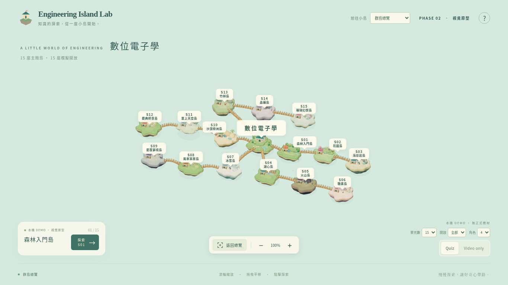
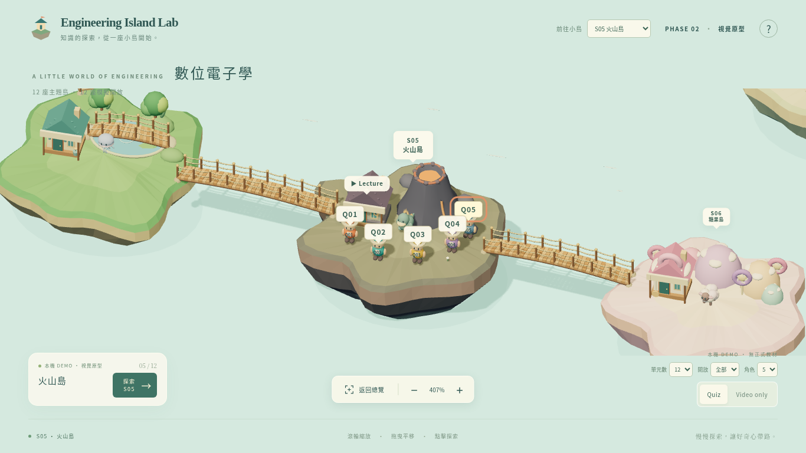
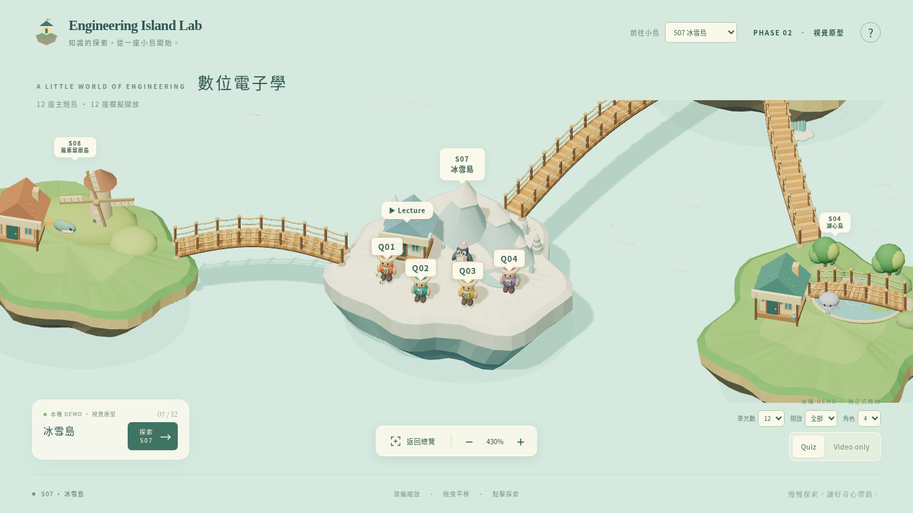
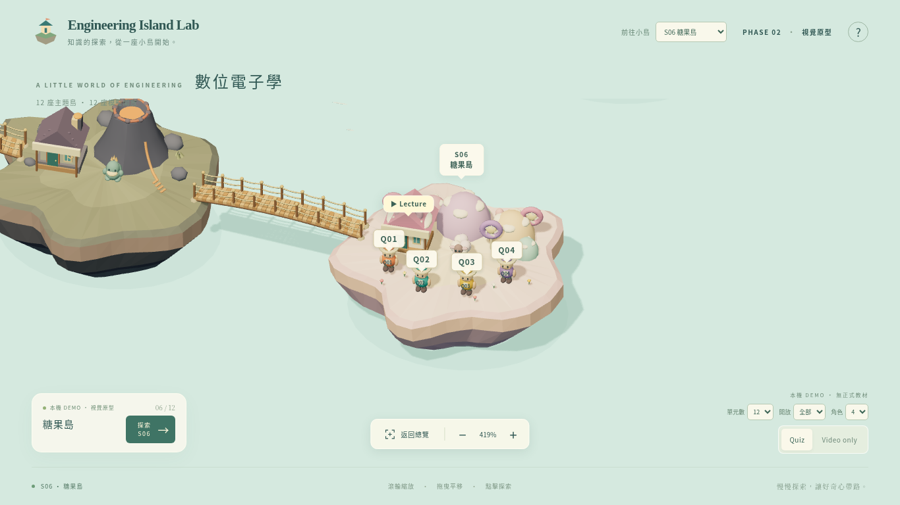
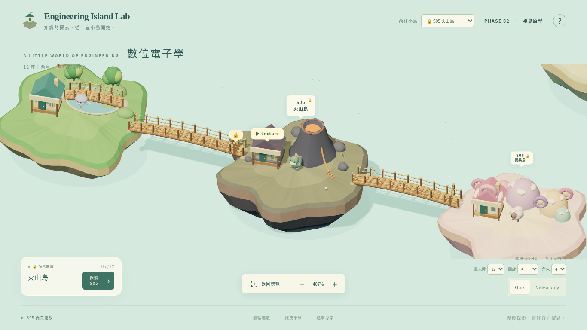
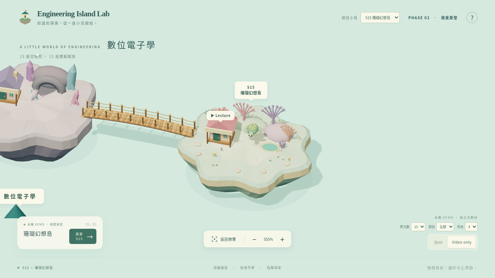

# Phase 2 — 完整群島交付與教師驗收

日期：2026-10-29（台北）。本輪只開發 Phase 2；正式教材清單仍為空。Phase 0／1 與木橋已由教師確認 Windows 11 驗收通過，PR #1 已合併。本輪從最新 main `3e5c883` 建立 `feature/phase-2-full-archipelago`，等待新的教師驗收，不能宣稱 Phase 2 已通過 Windows／美術／硬體效能驗收。

## 完成範圍與資料界線

- 中央學院＋依 `totalUnits` 產生 S01–S15，數位電子學預設 12。保留 S01 森林／小屋／NPC 造型及原跳鯊動畫，分離到 `world/phase-one.js`。
- 固定主題 preset 與不規則分支座標，沿用同一正交相機及連續世界；沒有 islands.json、學生化身、WASD、尋路或物理引擎。
- 每島獨特地貌、主題小屋、代表動物，清單見 README 的 15 島表格。不同半徑／深度／海岸輪廓與真正不同的岩拱、火山、雪峰、花圃、浮石、湖橋、風車、岩洞、珊瑚等大型結構。
- 每座島有一條完整的入島木橋，按實際海岸 Mesh 向下射線找接岸位置；已驗收 S01 橋延續原岸端。所有橋是視覺元素，無拾取、碰撞或通行系統。
- Manifest 是唯一正式開放來源：鎖定島保留地貌／色彩／動物，橋口加小木柵欄、3D 鎖與標示；點島、小屋或柵欄只聚焦並提示「Sxx 尚未開放」。開放後柵欄消失。
- Quiz 的本機視覺 fixture 支援 4／5 NPC 配置；Video only 完全沒有 NPC 模型、Q 標籤、拾取。全部 75 個 NPC 的身體目標已做合批後相機視線與實際射線拾取檢查。
- 總覽按 bbox fit，支援 1／12／15，最大縮放由 4 擴至 12；滑鼠操作與 click/drag 閾值保留。聚焦只顯示該島細節標籤，總覽標籤作小幅螢幕避讓；窄視窗可用原生單元導覽。
- 正式 `assignments/manifest.json` 保持 `{ "schemaVersion": 1, "units": [] }`，未加入題庫／影片／Form。Demo 使用相同 v1 形狀、僅在 Vite dev＋明確 Demo 開關下模擬開放數，production query 不能啟用。

## 實際平行開發與整合

先建立 [Island Factory Interface](ISLAND_FACTORY.md)，主 Agent 管理核心及統一座標／NPC／房屋契約，再實際透過 `spawn_agent` 同時啟動四組：

| Subagent | 唯一編輯模組 | 負責島 | 實際交付 |
|---|---|---|---|
| A `/root/nature_islands` | `world/islands/nature.js` | S02–S04 | 花園／海蝕岩拱／湖心、主題屋細節、魚尾／企鵝步態／水母脈動 |
| B `/root/fantasy_islands` | `world/islands/fantasy.js` | S05–S08 | 火山／糖果／雪峰／風車、特色屋、恐龍／羊／企鵝／游魚動畫 |
| C `/root/dream_islands` | `world/islands/dream.js` | S09–S12 | 月牙浮石／沙丘綠洲／雲階／慶典、觀星等小屋、蝴蝶／水母／跳鯊／魚／恐龍 |
| D `/root/extended_islands` | `world/islands/extended.js` | S13–S15 | 竹林流水／深岩洞／珊瑚礁、竹屋／晶燈／貝殼屋、熊貓／晶靈／海龜 |

四組都已回報建構、有限幾何、時間動畫、合批後動畫及實際 Chromium 近景結果，並停止編輯。沒有修改共享核心、設定、測試、AGENTS／Plan 或 Git refs／PR，沒有提出必須變更共用契約的問題。主 Agent 審查實際檔案與截圖後，才統一整合及重跑測試；四組沒有各自建立 PR。

共享記錄格式是 `{root, terrain, house, top, landmarks, animate[], creatures[{group,kind,update(seconds)}]}`。幾何在本地座標，核心統一放置；動物只接收絕對時間，動畫節點標記 `animated`，核心管理 NPC／標牌／拾取／橋／柵欄。主 Agent 平行完成布局、岸端、發布狀態、鏡頭、合批、遠景與陰影管理。

## 自動化驗證

最終執行順序依教師要求包含 `npm test` → `npm run build` → `npm run test` → `npm run test`，另執行原 Phase 2 要求的 `npm run test:smoke`、`npm run test:browser`。

| 命令 | 結果與內容 |
|---|---|
| `npm test`、兩次 `npm run test` | 三次各 41/41 通過；原 22 項以 totalUnits=1 保留雙島行為斷言，另加完整群島、15 主題、橋端實際落岸、無島體重疊、Manifest／柵欄、四／五題視覺配置、video-only、合批及 75 NPC 目標 |
| `npm run build` | 通過；主 JS 約 648 kB、gzip 約 173 kB，仍有既有 Three.js >500 kB 提示 |
| `npm run test:smoke` | 通過；模擬 Apache `/~wildwolf/engineering-island-lab/`，HTML／JS／CSS／favicon／JSON／空 Manifest |
| `npm run test:browser` | 20/20 通過：原 12 項操作回歸＋8 項完整群島檢查；結果及截圖由最終整合版本產生 |

瀏覽器檢查包含：12／15 島總覽與標牌不重疊、S13–S15 顯示條件、鎖定阻擋、柵欄隨開放消失、四／五 NPC、火山／雪／糖果小屋、所有動物無拾取、Video only、窄視窗、production Demo query 無效，以及零應用 JavaScript／Console error。自動化過程曾修正原測試只有一個鎖定島的 selector，沒有放寬鎖定規則。

## 效能方法與限制

- 共用 primitive 幾何與材質，花草使用 InstancedMesh。
- 靜態 mesh 依材質屬性／動作／細節／陰影分組，烘焙變換與頂點顏色後合併。保留 roughness、flat shading 與原造型；移動節點排除，再於自己的移動座標框架中合批。
- 遠景花草／NPC 細節隱藏，動物／環境動畫降至 6Hz；近景完整更新。可見性與 frustum culling 不改動動物行為。
- 總覽使用輕量 InstancedMesh 接觸陰影；聚焦才啟用高解析陰影，只讓該島／相接木橋及對應柵欄投影，避免整個群島同時重畫 shadow map。
- 重建釋放場景專用 geometry／material、instances 與 light shadow；共享 cache 保留供下一場景使用，不重複釋放活用材質。

效能測量在 **Linux Chromium 154、headless、DPR=1、ANGLE SwiftShader Vulkan 軟體 GPU** 上進行。每個樣本暖機後量測 30 個真實 requestAnimationFrame 間隔，draw calls／triangles 取 Three.js renderer.info。這是短樣本及軟體 GPU 的數據；目前在此環境並不流暢，不能外推為 Windows 一般筆電已達 30／60 FPS，也沒有取得實體 GPU timing 或 Windows Chrome／Edge 的本輪效能。

| 情境 | 實測 FPS | Draw calls | Triangles |
|---|---:|---:|---:|
| 15-unit overview / 1366x768 | 4.96 | 203 | 236,364 |
| 15-unit S01 focus / 1366x768 | 4.31 | 92 | 138,032 |
| 12-unit overview / 1366x768 | 6.00 | 167 | 179,190 |
| 12-unit overview / 1920x1080 | 4.71 | 167 | 179,190 |

原始數據保存於 [performance.json](acceptance/phase-2/performance.json)，Windows 可重跑 `npm run test:browser`（可用 `CHROMIUM_PATH` 指定 Chrome／Edge 執行檔），或本機 Demo 的 Console 讀取 `window.__islandLab.snapshot()` 取得當下 FPS／draw calls／triangles。教師仍需開啟硬體加速後親自確認美術與流暢度。

## 代表性截圖

### 12 島總覽

### 15 島總覽

### 主題近景

### 未開放島的完整橋與柵欄

### Video only

另提供 [1920×1080](acceptance/phase-2/wide.png)、[窄視窗](acceptance/phase-2/narrow.png)、[竹林](acceptance/phase-2/S13.png)、[晶礦](acceptance/phase-2/S14.png)、[珊瑚](acceptance/phase-2/S15.png)。

## Windows 本機驗收與停止點

完整 clone／切分支、安裝、測試與 11 項檢查表見 README。啟動 `npm run demo`，Chrome／Edge 分別以 1366×768、1920×1080 驗收：總覽數量與標牌、主題差異、S01 保留、橋端與柵欄、鎖定阻擋、聚焦／返回、4／5 NPC、模式及動物、Modal、窄視窗、Console 與實際 FPS。

本次不載入正式 Lecture／題庫，不實作判答、解答或 Google Forms；不加入後台、DB、登入、Notion API；不變更其他 repo、正式網站、Tag 或 Release。觸控只有基本點擊／單指平移／多指取消保護，未實作雙指縮放。Phase 3／4 與完整教材驗證工具仍待授權。

最終僅建立一個整合後的 Phase 2 Draft PR，停止等待教師實際驗收，不自行合併或進 Phase 3。
