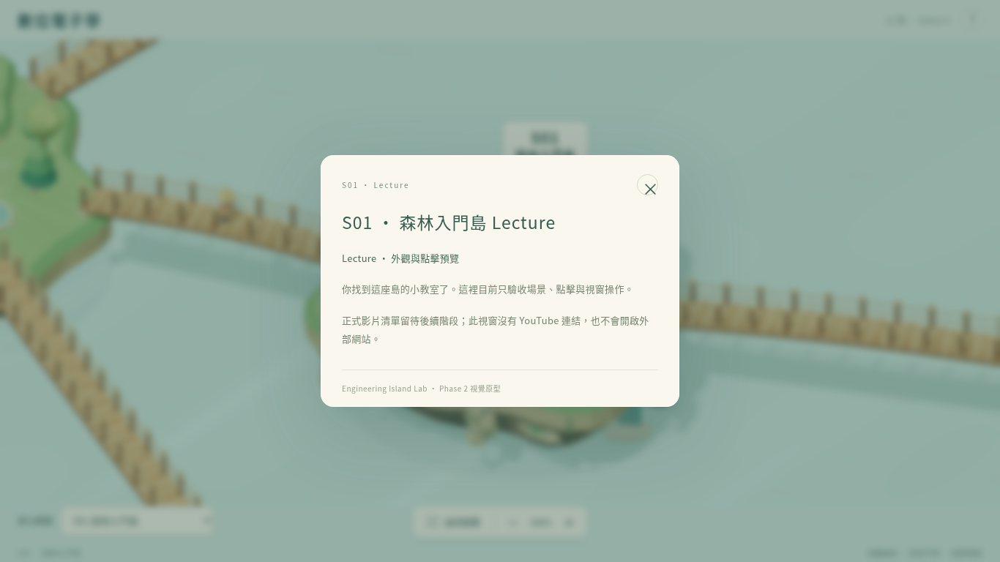
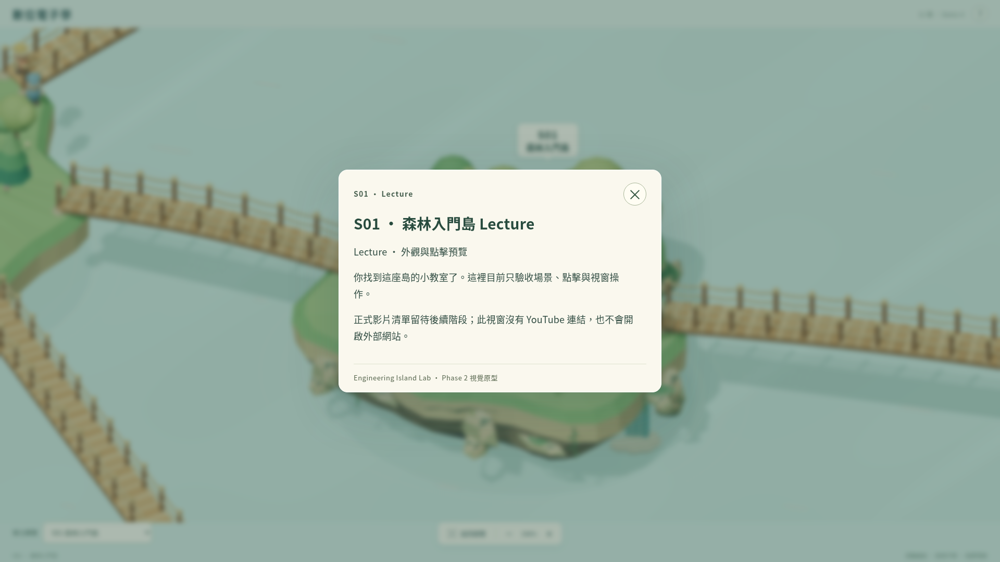
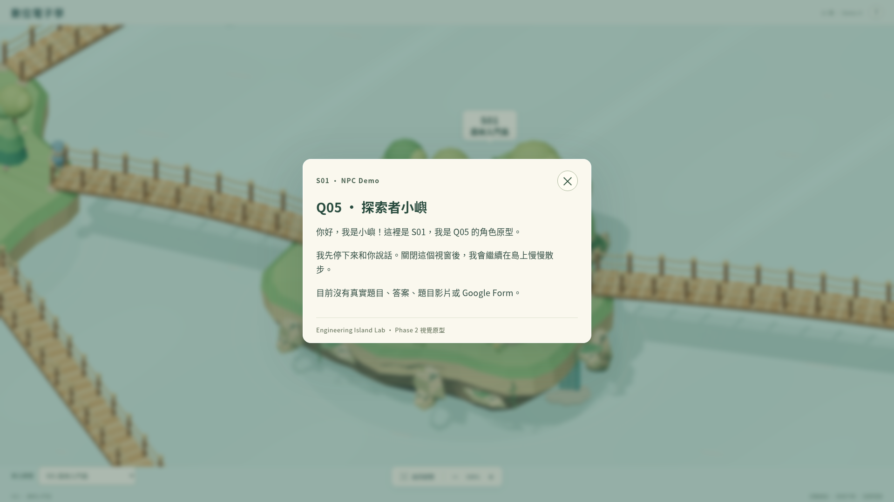

# Phase 2 — 共用 Modal 字體與版面驗收

> 2026-10-30：教師已完成 Phase 2 實機驗收，PR #2 已合併。本文件保留當時修訂紀錄；後續日夜／環繞開發另見 [Phase2.5](PHASE_2_5_ACCEPTANCE.md)，共用大字閱讀版面延用。

日期：2026-10-29（台北）。沿用 `feature/phase-2-full-archipelago` 及 [Draft PR #2](https://github.com/chingchechung/engineering-island-lab/pull/2)，本輪基準 `1854e26`。只改善 Lecture、Q01–Q05 與操作說明共用的原生 dialog，不修改 3D 場景、相機、群島布局、課程 JSON、Manifest 或 NPC 暫停／恢復程式。仍等待教師 Windows 11 重新確認閱讀品質，不進 Phase 3。

## 字體、對比與尺寸

| 項目 | 修正前桌面 | 新桌面 | 390px 窄畫面 |
|---|---:|---:|---:|
| 最大／實際寬度 | 490px | 最大 620px | 366px（左右各12px） |
| 主標題 | 23px | 28px | 24px |
| 主要內文 | 13px | 18px | 16px |
| 上方分類 | 10px | 14px | 14px |
| 底部附註 | 10px | 13px | 13px |
| 主要行高 | 1.95 | 1.75（31.5px） | 1.75（28px） |
| 關閉鈕點擊區 | 29×29px | 44×44px | 44×44px |

背景保留柔和米白 `#faf8ee`，內文改為較深的 `#344f45`。依 computed style 計算，內文對比 **8.39:1**、標題 **9.11:1**、分類 **6.25:1**、附註 **5.69:1**；全部文字高於4.5:1。這是文字顏色的相對亮度檢查，不代表整站無障礙認證。

- Native dialog 持續水平／垂直置中；桌面高度最多 `100dvh−32px`，窄畫面最多 `100dvh−24px`。
- 開啟時使用 flex column，標頭／44px 關閉鈕與附註不被內容擠出；只有 `.dialog-scroll` 可垂直捲動，沒有整頁或水平溢出。
- 長標題、長英文 token 可換行；內容區提供穩定捲軸空間。可用 Tab 聚焦「視窗內容」，再用 PageDown／方向鍵捲動，Esc 及關閉鈕沿用原行為。
- 所有視窗共用同一個 dialog、四個 `--modal-*-size` 變數與內文基礎字體。未來 Phase 3／4 的清單、選項與解答可沿用；本輪沒有提前實作這些內容功能。

## 實際版面量測

| 視窗尺寸 | Modal 寬度 | Lecture 高度 | Q05 高度 | 操作說明高度 |
|---|---:|---:|---:|---:|
| 1366×768 | 620px | 427.69px | 396.19px | 670.69px |
| 1920×1080 | 620px | 427.69px | 396.19px | 670.69px |
| 390×844 | 366px | 388.98px | 416.98px | 694.98px |

九個一般視窗都置中、文字達指定大小、關閉鈕／附註可見、沒有整頁捲動或水平溢出。另用24段純 Demo 長文字、重複長標題與英文 token 進行壓力測試：1366×768 的 Modal 高736px、上下各16px；390×320 高296px、上下各12px。內文可用鍵盤及滾輪捲動，標頭與關閉鈕維持可見，相機不移動。

原始量測：[修正前](acceptance/phase-2-modal/before.json)、[新版十一個版面情境](acceptance/phase-2-modal/layout.json)。長內容只由瀏覽器測試暫時注入 DOM，沒有改正式資料或 Demo fixture。

## 測試與保留行為

依指定順序執行 `npm test` → `npm run build` → `npm run test`，另執行 smoke 及完整瀏覽器回歸。最終結果：

- 兩次單元測試各 **91/91 通過**，保留全部原測試，沒有為 CSS 加入重複實作的單元斷言。
- build 通過；HTML 約2.78kB、CSS 約8.57kB，主 Three.js JS約702.40kB／gzip194.20kB，原有 >500kB 提示仍存在。
- Apache 子目錄 smoke 通過。
- 完整瀏覽器 **44/44 通過**：原32項保留，新增12項 Modal 閱讀／長內容檢查。
- 新增九個「三尺寸×三視窗」檢查，驗證實際字級、行高、顏色對比、寬度、置中、點擊區及溢出；另外驗證全部Q01–Q05的暫停／恢復，以及兩個長內容／矮視窗情境。
- 點 NPC 後位置保持不變，關閉後解除暫停；既有移動中模型／頭標的射線拾取及真正恢復走動測試亦保留。
- Modal 內鍵盤／滾輪不移動相機，關閉後原縮放／平移仍正常。一般動物、海面、四隻鯨魚與背景小旅人在 Modal 開啟時持續活動。
- 原12／15島、每島三動物、Video-only零題目NPC、鎖定柵欄與production參數隔離檢查均保留；零應用 JS／Console error。

瀏覽器為 Linux Chromium154／SwiftShader，截圖DPR=1；不是本輪 Windows 原生 Chrome／Edge 截圖，仍需教師實際確認字體與閱讀感受。場景效能背景資料保留於[生命感報告](PHASE_2_ACCEPTANCE.md)，本輪未改渲染或場景邏輯。原效能回歸仍執行，這次 SwiftShader 樣本約2.59–4.32 FPS，12／15島總覽仍為293／359 calls；[本次原始效能資料](acceptance/phase-2-modal/performance.json)另存供追溯，不據此宣稱UI改字改善3D效能。

## 新版截圖

原始瀏覽器截圖，未人工修圖。1366×768 的修正前後均由相同本機Demo設定產生。

### 1366×768：Lecture 前後

### 1366×768：NPC 前後

### 1920×1080

### 390px 窄畫面

另附操作說明 [1366](acceptance/phase-2-modal/about-1366.png)／[1920](acceptance/phase-2-modal/about-1920.png)／[390](acceptance/phase-2-modal/about-390.png)，以及長內容 [1366×768](acceptance/phase-2-modal/long-1366.png)／[390×320](acceptance/phase-2-modal/long-390.png)。

## Windows 11 再驗收

更新原分支後，依 README 執行 `npm ci`、`npm run demo`，使用 `?demo=1&units=12&open=4&questions=5`。

1. Chrome／Edge 分別以100%縮放、1366×768及1920×1080，點 S01 Lecture、Q01–Q05與右上操作說明。確認大字、深色對比、620px寬度與44px關閉鈕。
2. 切390px窄畫面，確認內文至少16px、左右留白、沒有整頁溢出，所有視窗仍置中。
3. 用操作說明或自動化長內容檢查內部捲動；標頭／關閉鈕維持可見，Tab聚焦內容區後PageDown可捲動，Esc與關閉鈕都正常。
4. NPC 點擊即停、關閉後恢復；Modal 期間背景動物、鯨魚與旅人繼續活動；滾輪不帶動地圖。
5. 關閉後重驗縮放／平移／返回總覽。正式空Manifest、Video-only及課程資料規則保持原樣。

完成後只更新原Draft PR #2，停止等待教師驗收。不得合併、Tag、Release、部署或進入Phase3。
