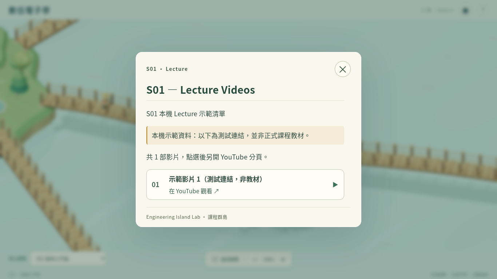
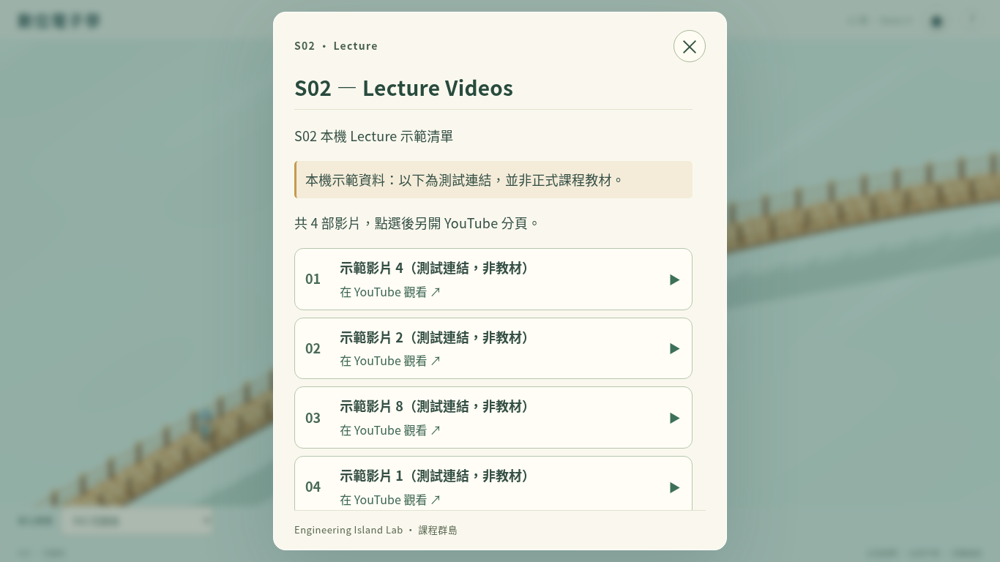
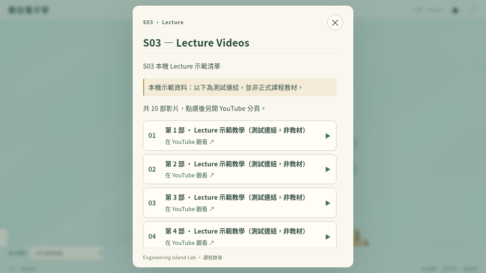
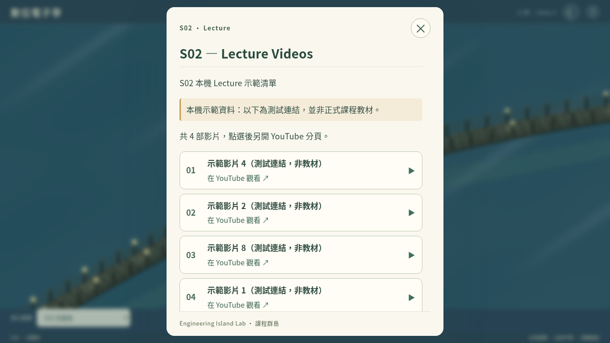
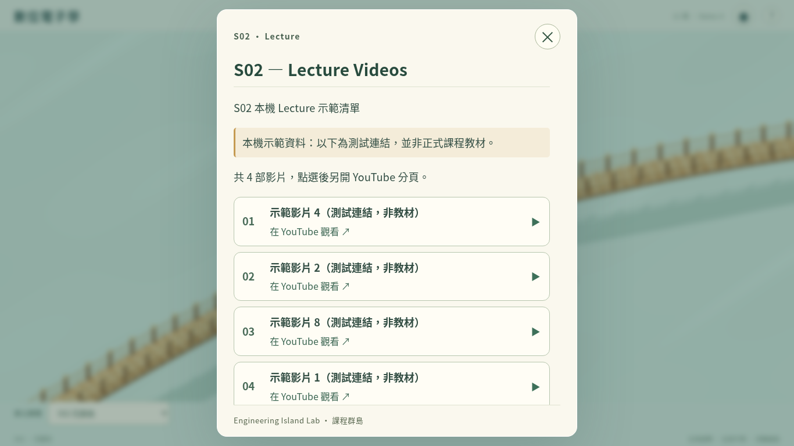
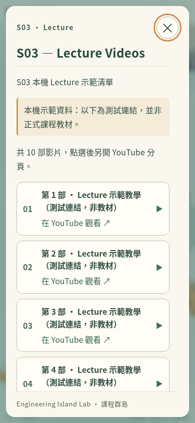
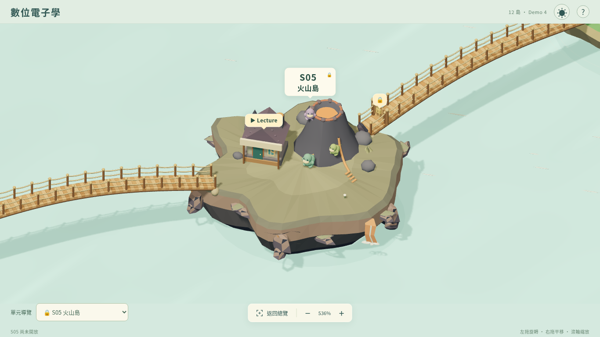
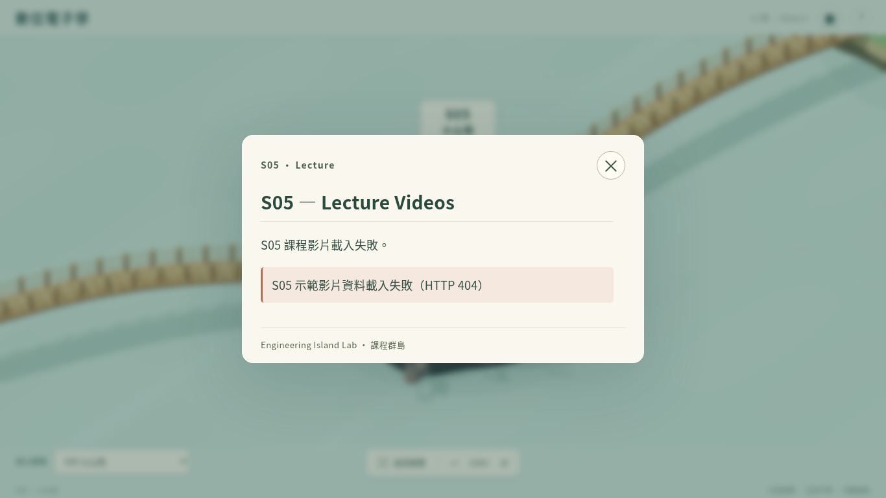
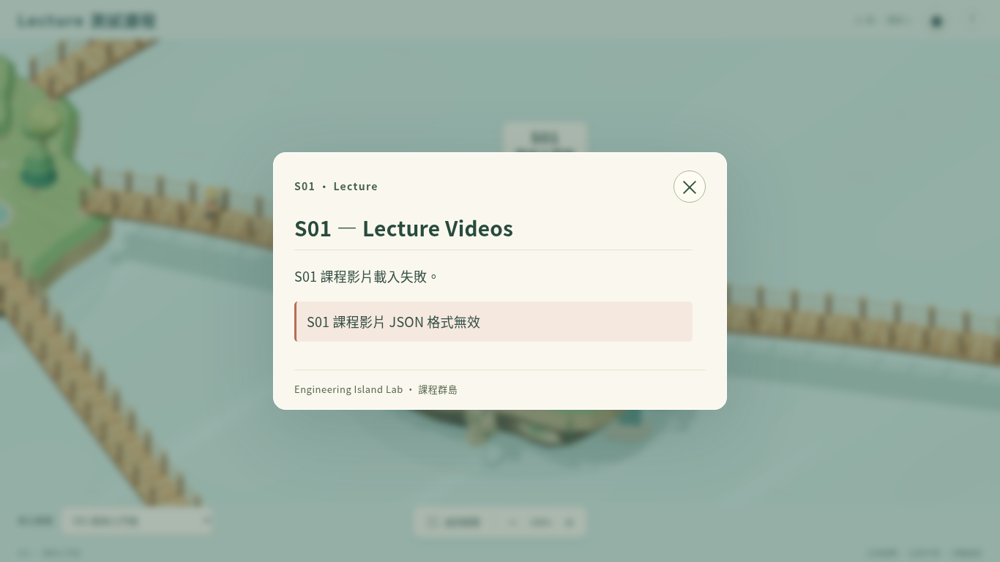

# Phase 3 — Lecture與每週教材發布驗收

> 歷史交付已完成教師 Windows 11 Chrome／Edge 驗收；PR #4 已合併至 main dd3f96f4（教師 Phase4 指示及 GitHub 狀態確認）。以下為當時測試記錄，Phase4 新結果另見 PHASE_4_ACCEPTANCE。

日期：2026-10-30（台北）。教師已確認Phase0–2.5 Windows 11 Chrome／Edge驗收，PR #1–#3合併；本輪從main `91f33c2`建立`feature/phase-3-lecture-publishing`，只交付唯一Draft PR #4後停止，不進Phase4、不合併／部署／Tag／Release。

授權原文：[PHASE_3_BRIEF](PHASE_3_BRIEF.md)。資料格式沿用[CONTENT_AND_RELEASE](CONTENT_AND_RELEASE.md)，沒有新增必填欄位、語言分類、islands.json或第二套發布清單。正式public JSON與空Manifest完全不變，沒有讀取或發布真實課程影片。

## 完成內容

- 全部S01–S15共用Lecture Loader與清單Modal；只有Manifest已開放單元可載入固定相對路徑`./course-videos/Sxx.json`，鎖定單元不發請求。
- 保留原始標題／URL及videos[]順序，允許1／4／10／30或更多影片，不排序、不分CHT／ENG、不要求英文、不嵌入／自動播放或追蹤。
- 嚴格白名單S01–S15及totalUnits範圍、對應unitId、非空標題與HTTPS YouTube影片URL。拒絕帳密、偽網域、非HTTPS、javascript/data、無效影片ID與任意檔案路徑。
- 記憶體快取成功驗證資料，凍結清單，合併同時請求；失敗可重試。載入／空清單／HTTP或JSON／非法資料顯示不同明確訊息，不虛構或替換其他單元影片。
- 共用native dialog保留620px、28／18px、手機16px及44px關閉鈕。Lecture標題固定，長標題換行，清單內捲而非整頁；關閉／Esc與焦點回復保留。
- 原生連結`target=_blank rel="noopener noreferrer"`，只有使用者點擊才開外頁；原Modal及捲動位置保留。沒有縮圖、iframe或內嵌播放器。
- Dialog revision同時隔離單元切換、關閉與NPC／操作說明；舊載入回應無法覆蓋新視窗。queued native close在已開新session時不破壞新狀態。
- Quiz與video-only使用同一Lecture功能；Demo NPC漫遊、點擊停止與關閉後恢復保留。正式Quiz判答／解說／Google Form未實作、不假裝作業已準備完成。

S01在舊原型中曾以NPC fixture決定小屋可點與島標牌樣式。Main將這兩項接線改由Manifest決定；正式開放S01在無Demo NPC時也能開Lecture。只修改互動metadata，沒有重做島嶼、相機、燈光、動物或布局。

## 模組與實際平行交付

先建立[凍結介面及所有權](PHASE_3_INTERFACES.md)，實際呼叫spawn_agent同時執行，兩者已全部交付並停止：

| 負責人 | 檔案與交付 |
|---|---|
| A `/root/phase3_data` | lecture-data.js、validate-content.js及兩份Node測試；Loader／驗證／URL／快取及唯讀CLI，20/20通過。 |
| B `/root/phase3_ui` | lecture-ui.js、lecture.css、lecture-ui.test.js、lecture-component-browser.js；共用清單與狀態，14/14通過；原生Dialog三尺寸12布局、popup、極長h2及立即關閉重開驗證。 |
| Main | main.js／ui.js／S01 metadata、Demo fixture、package腳本、整合瀏覽器／Apache smoke、文件及唯一PR；另兩項正式S01無NPC fixture回歸。 |

Subagents沒有同時改共享核心、設定、正式資料或Git，沒有各自建PR。Main審查實作後才整合，沒有增加依賴或更動lockfile。

## Content Validator與教師流程

`npm run validate:content`唯讀檢查course-config、Manifest及所有已開放Lecture；`--unit S04`只檢查單一候選Lecture，`--root dist`可改驗證靜態根目錄。所有單元都使用同一驗證器，拒絕缺檔／空清單／編號不符／無效URL，原順序列出影片供教師核對。

- video-only不需要、不讀assignments/Sxx.json；file欄位仍留在Manifest相容格式。
- quiz完整性明示Phase4尚未支援，預設正式非空Quiz發布檢查回非零，即使Lecture有效也不宣稱可發布。候選Lecture可以單獨通過，但明示不代表作業或發布就緒。
- 本專案現在quiz且Manifest為空，命令可回0並明示沒有任何教材已發布、Quiz未驗證；不是作業就緒證明。
- 工具不改寫／排序JSON，不更動Manifest、不build／部署；也不查YouTube API或自動比對PDF順序。

[TEACHER_PUBLISHING](TEACHER_PUBLISHING.md)及README提供完整可複製Prompt：Notion先捲到底、確認完整PDF→指定Sxx／順序→AI只擷取Lecture→驗證與差異→教師核對→先內容、最後Manifest。缺頁／不清網址必回報，不猜、不套用上一學期或混入題目／解答。Manifest不是秘密資料存取保護；未公開題庫不能放入可下載路徑。

## Demo／正式隔離

S01一部、S02四部、S03十部、S04不同順序、S05缺資料，其他單元共用安全格式示例。全部放src/demo，明示測試連結非教材。只有Vite DEV且demo=1時才動態import；production build直接移除Demo分支，所有query覆寫均忽略。

正式資料測試使用Playwright HTTP攔截或/tmp下的dist副本，不改public／正式dist的Manifest；對外YouTube也由測試攔截，驗真實popup與opener隔離而不連外站。

## 測試結果

基準112/112與build通過。新增資料／CLI20、UI14與Main整合2項，整體148項。最終結果：**148/148單元、build、兩段Apache smoke、65/65完整瀏覽器、validate:content全部通過**，零應用JS／Console error。build主JS723.27kB／gzip201.59kB，保留原Three.js >500kB提示；production不產生Demo fixture chunk。原始[五命令輸出](acceptance/phase-3/verification.txt)、[整合版面及請求路徑](acceptance/phase-3/layout.json)、[原生元件版面](acceptance/phase-3/component-layout.json)已保存。

保留原56項Phase2.5行為（Lecture占位斷言依本輪改為明示Demo連結），新增九組Lecture場景檢查：數量與順序、sticky／popup／捲動／相機隔離、兩模式／Night、1920與390、鎖定／缺檔、empty／非法、延遲與cache、30部長標、Apache production S15。共用Modal原三尺寸與長內容、NPC／背景生命、Day／Night／Orbit及正式隔離仍完整回歸。

Apache smoke先驗原正式dist資源及空Manifest，再用/tmp可丟棄副本放video-only測試資料，實際HTTP載入`/~wildwolf/engineering-island-lab/course-videos/S01.json`並核對異序，沒有assignment檔仍通過。這是本機Apache路徑情境，不是學校站台部署。

## 代表性原始瀏覽器畫面

以下為真實Linux Chromium／WebGL畫面，沒有AI生成或修圖。Demo連結均非本學期教材；Windows字體與實際操作仍待教師確認。











另附[S04異序](acceptance/phase-3/S04-order.png)、[1920](acceptance/phase-3/1920.png)、[empty](acceptance/phase-3/empty.png)、[30部長標](acceptance/phase-3/thirty-long.png)及[Apache production](acceptance/phase-3/apache-production.png)。[既有場景效能回歸](acceptance/phase-3/scene-performance.json)保留原八樣本的renderer／FPS／calls／triangles；這是SwiftShader，不是Windows硬體數據。

## Windows 11 Chrome／Edge 驗收

```powershell
git fetch origin
git switch feature/phase-3-lecture-publishing
git pull --ff-only origin feature/phase-3-lecture-publishing
npm ci
npm test
npm run build
npm run test:smoke
npm run validate:content
npm run demo
```

開啟http://localhost:5173/?demo=1&units=12&open=4&questions=5，兩款瀏覽器各以1366×768、1920×1080、390px驗收：

1. S01／S02／S03分別1／4／10部；S04維持第三章、第一章、第二章，沒有語言分組或排序。
2. 影片列與標題清楚、可Tab操作，長清單內捲；標題、44px關閉鈕可見，沒有整頁／水平溢出。
3. 點影片另開YouTube，回來Modal仍開、捲動位置保留。Demo是格式測試連結，可能不是可播放的真影片。
4. 滾輪／拖曳／鍵盤不移動背景相機，Esc／關閉正常；NPC停止／恢復與背景生命保留。
5. Night、90／180度旋轉後再開Lecture；原右拖／Shift平移、縮放／總覽正常。
6. mode=video-only沒有NPC／題庫請求；open=5看S05缺資料，open=4時S05仍鎖定且不載Lecture。
7. 預設入口及npm run preview即使加Demo參數仍依正式空Manifest鎖定全部，沒有測試影片或真實教材發布。
8. 教師依TEACHER_PUBLISHING的Prompt準備候選資料；驗證命令只報告、不開放單元，Quiz未完成必明示。

自動化瀏覽器可設CHROMIUM_PATH指定Chrome／Edge，再執行npm run test:browser；未設定時需先npx playwright install chromium。本環境為SwiftShader軟體GPU，未宣稱完成本輪Windows實體GPU驗收。

## 尚未實作與停止點

Phase4才處理正式Quiz v1/v2、判答／解說與Google Form；本輪不讀／寫正式題庫。沒有YouTube公開狀態API、Notion API、爬蟲、編輯GUI、後端、登入、DB或觀看紀錄。資料快取僅本頁記憶體，重新整理清除；Manifest更新後需重載頁面。

正式Manifest保持空清單，沒有合併、Tag／Release或部署。本輪只交付唯一Draft PR #4後停止，等教師Windows驗收，不自行進Phase4。
