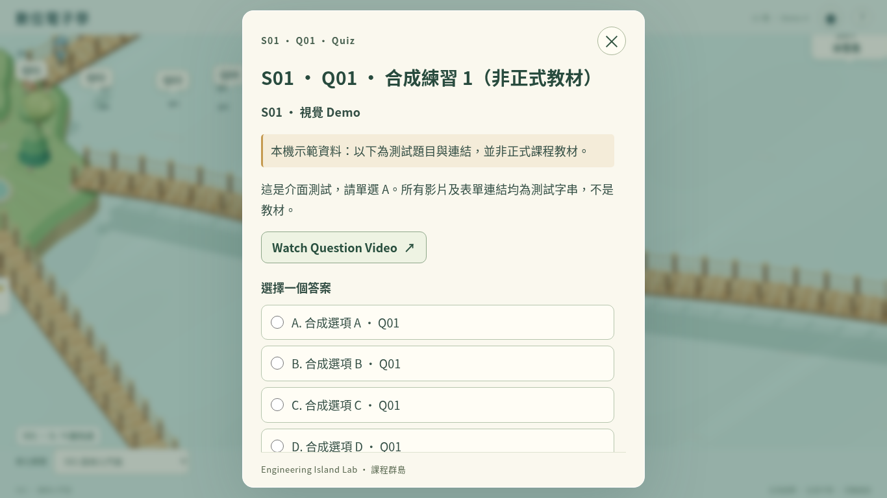
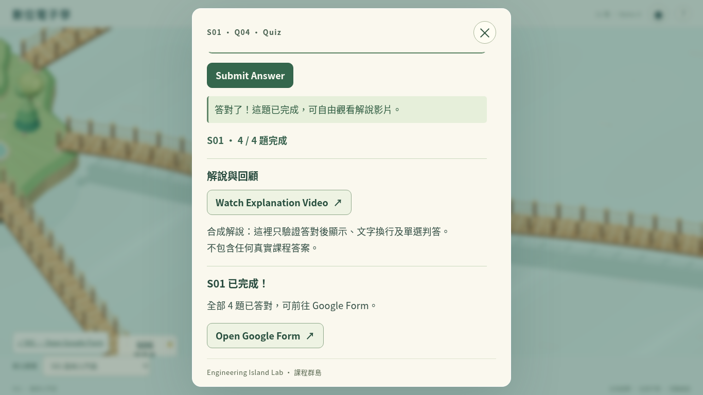

# Phase 4 — NPC Quiz 與 Google Forms 驗收

2026-10-30（台北）。教師已確認Phase0–3在Windows11 Chrome／Edge驗收，GitHub確認PR #4合併於main `dd3f96f4c301f0f4ecfbe1a4ffc7e360ecacd159`。本輪在 `feature/phase-4-quiz-integration` 開發，只交付唯一Draft PR #5；不合併、部署、Tag／Release或進Phase5。

原始授權：[PHASE_4_BRIEF](PHASE_4_BRIEF.md)。正式course-config及Manifest完全不改，`units:[]`，沒有真實題目、答案或教材發布。

## 實作與驗收範圍

- 精確沿用City／Maze的v1/v2：四／五題、順序Q01–Q04/Q05、v1四選項／單一正解，v2三／四選項／多個可接受的**單選**答案；不補D、不轉版本。題目及解說影片仍必填，選看影片不影響判答。
- 只載入Manifest開放的固定相對題庫路徑，先嚴格驗證欄位／ID／檔名／課程範圍／normalize後title。頁面啟動時平行讀開放題庫，每筆15秒上限；成功深凍結cache／同單元single-flight，各島請求獨立，取消／clearCache以request identity拒絕舊回應。
- 每座島的NPC由該島有效JSON產生，同一世界四／五位共存。失敗單元沒有假NPC，導覽旁有清楚錯誤入口，維持quiz；有效島及Lecture仍正常。既有NPC模型、地表安全、漫遊／停止／恢復、模型及Q標拾取沿用。
- 共用620px、28/18px、手機24/16px、44px關閉鈕Modal。單選radio、Submit Answer、原題目影片、錯答重試、答對解說及選用原文；全部textContent。回饋更新保留radio／焦點／捲動；新開題目或關閉重開從頂部開始，外部新分頁返回保留原捲動。revision防止舊／已關閉表單修改新Modal。
- 每unitId各自頁面記憶體Session，錯答或重訪錯答不撤銷通過；切島／相機／日夜／Lecture保留，重新整理清除。不以觀看影片或到達某位置作為完成條件。
- Q標／帽衣標以CSS綠色與✓表示完成，沒有新增3D物件或draw calls。4/4或5/5才顯示該單元原Form URL，Modal及導覽旁小入口共用同一Session投影；沒有第二個進度計數或大型HUD。
- 所有影片／Form都是原生安全新分頁，只有實際click／Enter才導覽；原Modal保留，不嵌入、不自動播放、不追蹤或提交Form。
- `assignmentMode=video-only`不建立Q／Quiz／進度／Form，不讀Assignment，亦不下載Quiz runtime／CSS。Lecture和15島、動物、鯨魚、旅人、海面、橋、柵欄及日夜維持原狀。

## 實際平行分工與審查

Main先凍結[介面／所有權](PHASE_4_INTERFACES.md)，實際呼叫spawn_agent三位並行；三者全部回報後停止編輯，Main審查、實際執行並統一整合：

| Agent | 所有權與結果 |
|---|---|
| A `/root/phase4_contract` | quiz-contract／legacy-assignment、Schemas、來源snapshots／corpus、parity、相容文件。14項契約測試及完整跨語言對照通過。 |
| B `/root/phase4_data` | quiz-data／quiz-session及兩份測試。21項Loader／Session通過，取消及錯誤保完整issues。 |
| C `/root/phase4_ui` | quiz-ui／quiz.css、UI測試與獨立native browser。22項通過，三尺寸、極端長文、鍵盤、舊事件及三個實際攔截popup通過。 |
| Main | 共享核心、NPC appearance適配、混合題數、綠標／精簡入口、Demo、Content Validator／6項新增測試、browser／smoke／文件與唯一PR。 |

沒有Subagent改共享核心／package／正式資料或各自開PR。Main的Production審查確認UMD在Vite build經CommonJS包裝，橋接沿用City的`legacy.default ?? globalThis.AssignmentValidator`雙命名空間選擇；原演算法／原URL bytes不變，實際Apache production覆蓋此路徑。Main亦修正native Dialog隱藏時scrollTop寫入無效的邊界：新內容在showModal及close聚焦後才重設至頂部；三尺寸關閉重開驗0px，外連返回仍保原scroll。

## 舊契約相容性

City v1.0.0實際commit `38b1dfdd73d766ec1d01999216b24dfca2126fad`，Maze固定commit `70cc35d9ce828bcd5357f16fe85f303aa2d30cd9`。完整來源／授權及精確差異見[ASSIGNMENT_COMPATIBILITY](ASSIGNMENT_COMPATIBILITY.md)。來源checkout維持乾淨，14份snapshot SHA256逐檔受測。

原364驗證案例與76次單選判答全部重播，normalize／選項順序及接受／拒絕結果沒有變動。11個errors列表差異嚴格限於S15文字、S13合法化及15筆上限；原非法檔名／重複單元仍被拒絕，沒有略過案例。另17個擴展案例（v1/v2×四/五題×S12–S15及15筆Manifest）與381個Schema案例通過，獨立Python／Schema parity通過。

未修改其他Repository或舊Python GUI；使用S13–S15前須另確認GUI支援，或教師授權AI／手動按相同Schema產出並驗證。原Maze沒有根LICENSE，重用依教師明示授權，沒有推定為MIT；原headers／來源註記保留。

## 指定命令與瀏覽器

指定五命令全部成功：`npm test` **211/211**、`npm run build`、`npm run test:smoke`三段、`npm run test:browser` **76/76組**、`npm run validate:content`。另`node scripts/legacy-parity.mjs`通過364／76及17／381對照。沒有失敗／跳過或應用JS／Console error。完整命令輸出與時間見[verification.txt](acceptance/phase-4/verification.txt)及[verification.json](acceptance/phase-4/verification.json)。

保留Phase3的148項測試並增加63項：A14、B21、C22、Main6；既有CLI「Phase4尚未支援」歷史斷言更新為驗真題庫及空清單不冒稱就緒。原65組瀏覽器驗收意圖全部保留，新增11組完整Quiz整合。獨立native UI helper另通過三尺寸、極端長標、鍵盤／舊事件及三個攔截popup。

Production主JS727.37kB／gzip203.33kB，Quiz動態JS16.31kB／gzip6.51kB及CSS2.86kB；Video-only實測不下載Quiz chunk或題庫。既有Three.js >500kB提示仍在，沒有新增依賴或變動lockfile。

瀏覽器覆蓋保留原Phase3全部65組，新增Quiz流程、混合題數、S13–S15、HTTP／JSON／契約失敗、取消舊文件、Production模式及資源隔離。既有180°模型／Q01–Q05、Modal相機隔離、背景持續活動、360°環繞、日夜／手機／多指及Lecture回歸保留；四處舊NPC Demo標題斷言改為新`S01 · Qxx`格式，沒有移除原驗收意圖。

外站在context層攔截，Question／Explanation／Modal Form／小入口Form以真實原生click開啟，驗URL精確、無opener／referrer、原Modal／進度保留。獨立UI helper另驗Enter、radio鍵盤與原scroll。測試不向YouTube／Google提交；預期HTTP404只出現在受控失敗案例。

Smoke先驗原dist／正式空Manifest與相對assets，再用/tmp的dist副本真實HTTP驗video-only Lecture及quiz v1/v2、四／五題、S15；測試後刪副本，public／正式dist內容不變。production忽略全部Demo／mode／題數參數；無debug API。

## 代表性實際截圖

共20張本輪實際截圖（18張Quiz整合、180°回歸、native手機解說），沒有AI示意圖或修圖。

| 驗收 | 截圖 |
|---|---|
| 錯答／解說／v2任一接受答案 | [重試](acceptance/phase-4/retry.png)、[解說](acceptance/phase-4/explanation.png)、[v2 A或C](acceptance/phase-4/v2-alternatives.png) |
| NPC配置與綠標 | [S01四位](acceptance/phase-4/S01-four-npcs.png)、[S02五位](acceptance/phase-4/S02-five-npcs.png)、[部分完成](acceptance/phase-4/partial.png)、[全部綠標與小入口](acceptance/phase-4/all-green.png) |
| 完成門檻 | [4/4 Form](acceptance/phase-4/four-complete.png)、[5/5 Form](acceptance/phase-4/five-complete.png) |
| Night／180° | [Night Quiz](acceptance/phase-4/night.png)、[180° Q05](acceptance/phase-4/npc-night-180.png) |
| 三尺寸 | [1366](acceptance/phase-4/1366.png)、[1920](acceptance/phase-4/1920.png)、[390](acceptance/phase-4/390.png)、[手機解說與literal文字](acceptance/phase-4/component-390-explanation.png) |
| 模式與錯誤 | [Video-only](acceptance/phase-4/video-only.png)、[題庫JSON錯誤](acceptance/phase-4/load-error.png)、[Apache production合成S15](acceptance/phase-4/apache-production.png)、[正式空Manifest](acceptance/phase-4/empty-manifest.png) |

三尺寸量測見[layout.json](acceptance/phase-4/layout.json)及[native UI結果](acceptance/phase-4/quiz-component-layout.json)。桌面28／18px，手機24／16px，close44px；無整頁或水平溢出，長內容在Modal內捲動。

## 效能

本輪雲端只有Linux Chromium154／SwiftShader軟體GPU，DPR1。以相同1366×768 viewport、連續20個requestAnimationFrame平均量測12／15島混合題數總覽、15島單島聚焦、Night及Video-only。保留逐幀ms、draw calls、triangles、NPC／動物／鯨魚／旅人數與renderer字串。

| 情境 | NPC | FPS | Draw Calls | Triangles |
|---|---:|---:|---:|---:|
| 12島總覽 · Quiz | 54 | 3.95 | 300 | 270,754 |
| 15島總覽 · Quiz | 67 | 3.21 | 368 | 344,606 |
| 15島S02聚焦 · Quiz | 67 | 4.23 | 181 | 146,609 |
| 15島夜間總覽 · Quiz | 67 | 3.16 | 374 | 358,270 |
| 15島總覽 · Video-only | 0 | 3.33 | 368 | 344,606 |

實際renderer：`ANGLE (Google, Vulkan 1.3.0 (SwiftShader Device (Subzero) (0x0000C0DE)), SwiftShader driver)`。原始逐幀與數量見[scene-performance.json](acceptance/phase-4/scene-performance.json)，完整網路／popup／layout紀錄見[quiz-audit.json](acceptance/phase-4/quiz-audit.json)。12島36動物／7旅人、15島45動物／8旅人，兩者4鯨魚仍在；Quiz使用混合54／67位NPC，另原五題75位NPC回歸也通過。

本輪環境沒有`/dev/dri`、`/dev/nvidia0`或nvidia-smi，沒有可用實體GPU或新的Windows FPS數據。先前教師已確認Phase0–3在Windows硬體加速流暢，不能代替本輪新增Quiz的實機驗收。軟體GPU速度不得當一般筆電流暢度結論。沒有改地貌／相機／日夜／動畫；完成標示使用DOM／CSS，不增加WebGL幾何。

## Windows11 Chrome／Edge 教師驗收

1. 按README取得指定分支，`npm ci`、`npm test`、`npm run build`、`npm run test:smoke`、`npm run validate:content`；`npm run demo`。先驗正式預設空Manifest全部鎖定。
2. 開`http://localhost:5173/?demo=1&units=12&open=4`。S01 v1四題、S02 v2五題、S03 v2四題、S04 v1五題，檢查Q數量／單選三或四項。不必觀看影片便可作答。
3. S01正解依序A/B/C/D，先錯答再重試；綠標及解說只在通過後出現。已通過題重訪錯答，通過／解說仍保留；不要把錯題誤當全單元重置。
4. S02／S03每題單選A或C皆通過，不能同時勾選。3/4、4/5無Form，4/4、5/5才有，Q05不存在的島不列入計數。Form URL為該單元資料，導覽旁小入口在關閉後可找回。
5. 所有Demo網址是合成驗證字串，不是實際課程／表單；自動化browser已攔截外連並驗新分頁，教師不應對合成Form提交資料。真教材發布前另依教師政策核對學生可觀看／可提交。
6. 換島／總覽／旋轉／縮放／日夜／Lecture再回原島，已完成仍保留；重新整理全部清除。沒有帳號、觀看時間、表單提交偵測或永久紀錄。
7. 在1366×768、1920×1080、390px：Modal字級／對比、內捲、44px關閉、Esc／Tab／radio方向鍵／Enter可用；不產生整頁／水平捲動。Modal開啟相機不動，該NPC停止，背景生命繼續；關閉後NPC恢復。
8. 旋轉180°後點模型和Q標；Lecture仍按原序1／4／10／異序，外開不關Modal。360°環繞及總覽／聚焦取景保留。
9. 15島全開`?demo=1&units=15&open=15`，確認每島三動物、四鯨魚及背景旅人不可互動。加`mode=video-only`後沒有Quiz／Form／題庫請求，Lecture與生命保留；正式production不能靠query開放。
10. 依下方發布工具以私人暫存目錄準備錯誤／有效內容，不改正式Manifest。記錄Chrome／Edge版本、GPU／硬體加速、FPS、Draw Calls、Triangles及美術／操作觀察，交教師決定是否合併。

## 發布工具與限制

`npm run validate:content -- --unit S04`保留Lecture候選；加`--with-quiz`同驗題庫。預設驗Manifest全部開放內容（quiz時含Assignment及normalized title），空清單可成功但明示沒有單元發布，不能聲稱已有作業就緒。video-only不需要／不讀題庫。工具唯讀、不改JSON、不部署；候選尚未列Manifest時，後續仍須確認擬加入的title相同。

[教師發布文件](TEACHER_PUBLISHING.md)有完整Lecture／Quiz Prompt：先完整PDF及教師授權題庫→保留原契約／原序→完整候選驗證→教師核對影片／Form與差異→核准後先內容、確認HTTP→最後Manifest。網站不從Notion自行產真題。

頁面啟動讀取一次Manifest與開放題庫，更新教材後需重載；重載會清除當頁作答。沒有頁面內熱換題庫／成績同步，載入錯誤不造題也不擅自改模式。URL驗格式不驗供應商內容／可用性；不偵測影片是否觀看或Form是否提交。公開JSON包含答案，是練習平台而非安全考試；Manifest不能保密，私稿不得放公開路徑。

完成後停在唯一Draft PR #5，等待教師Windows實機驗收。
