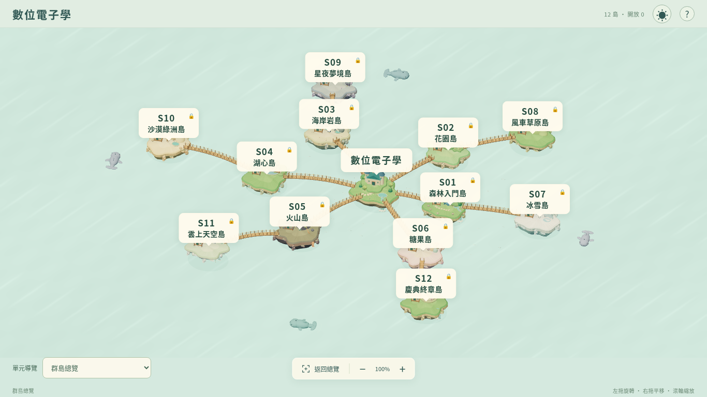
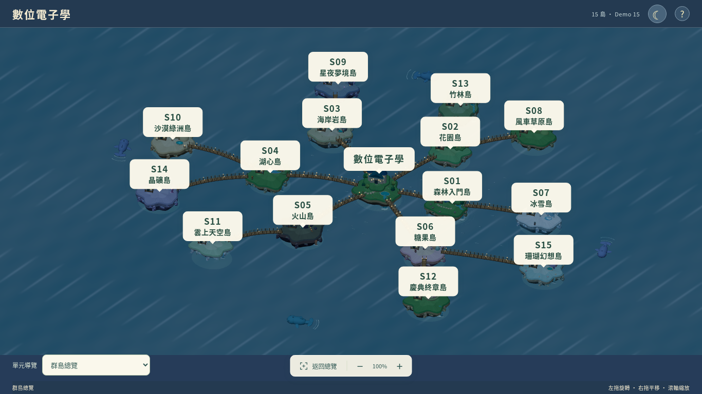
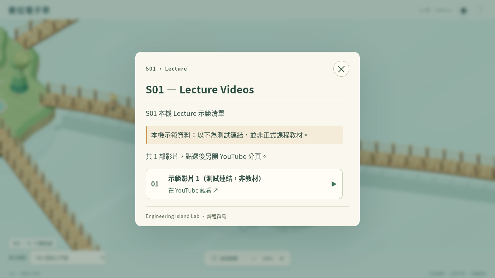

# Phase5 — Release Readiness & Deployment Validation

> 後續教師已確認Windows11 Chrome／Edge十項最終驗收全過，PR #6已合併main `a116165b`。本文件保留當時RC實測與待驗歷史，不代表目前仍待Windows驗收；最新正式封裝準備見 [v1.0.0](releases/v1.0.0/PREPARATION.md)。本輪仍未Tag／Release／部署。

2026-10-30 UTC；基準 main `046efcab7b359cce046038fe66c95c5821edfad4`。教師已確認Phase0–4及Windows EOL驗收，PR #1–#5合併。本輪分支 `feature/phase-5-release-readiness`，只交RC與唯一Draft PR #6；未合併、Tag、Release、改可見性、部署學校或發布真實教材。

交付：唯一 [Draft PR #6](https://github.com/chingchechung/engineering-island-lab/pull/6) 已建立並維持Draft；Main停止等待教師RC／Windows驗收。

完整指示：[PHASE_5_BRIEF](PHASE_5_BRIEF.md)；先凍結的介面：[PHASE_5_INTERFACES](PHASE_5_INTERFACES.md)。

## 已完成範圍

- 原生Node24 ZIP封裝：實際build先通過唯讀release scan，逐檔重讀hash後封裝；ZIP根即網站內容，固定metadata、同輸入bytes可重現；不依賴系統zip或新增npm依賴。
- 實際dist allowlist、相對／lazy資源引用檢查、授權notice、未列出教材／private／test／備份／Demo／dev API／本機路徑／高可信度憑證掃描；重用既有Content Validator。通過不等於人工教材審查或發布許可。
- 嚴格Node靜態HTTP模擬，及本機Docker **真正Apache2.4.69** 各跑三段smoke：正式空清單、Video-only Lecture、v1/v2四五題與S15。正確MIME、真404、trailing slash、巢狀目錄、直接重載、HTML／JSON freshness與雜湊asset immutable。
- Production瀏覽器在Node模擬及真正Apache驗正式12島全鎖、忽略所有Demo query、無debug／教材請求；1366×768、1920×1080、390px操作說明Modal。私人暫存Video-only情境驗同URL Manifest更新後reload開放S01、Lecture可用、沒有Quiz chunk／JSON請求；合成內容不進RC。
- 繁中教師SOP、Apache含選用.htaccess／前置條件、RC與正式發布清單、來源授權inventory、安全／audit／EOL證據。

已驗收產品功能沒有重寫。`src/`、正式JSON、JSON Schema／Legacy判答、14份pinned原始bytes及SHA預期、`.gitattributes`、Vite相對base、依賴／lockfile均保留。[96個既有程式／設定／測試檔逐bytes比對main](acceptance/phase-5/protected-files.json)完全一致；另有新增Phase5工具測試。唯一正式網站新增是完整第三方notice；改動集中於驗證／封裝工具與文件。

## RC、inventory與SHA256

- [engineering-island-lab-v1.0.0-rc.zip](../artifacts/release-candidate/engineering-island-lab-v1.0.0-rc.zip)：**216,989 bytes**（約211.90KiB）。
- 解壓9個檔案，合計 **771,969 bytes**。根有index.html，沒有外層dist/；檔案權限0644。
- [ZIP SHA256](../artifacts/release-candidate/engineering-island-lab-v1.0.0-rc.sha256)：`a19b086ed83e587a516769680407ff206e5291f8ed4088ade05fa2044e9448ad`。
- [逐檔inventory／SHA](../artifacts/release-candidate/engineering-island-lab-v1.0.0-rc.files.json)、[scan receipt](../artifacts/release-candidate/engineering-island-lab-v1.0.0-rc.report.json)、[獨立解壓核對](acceptance/phase-5/zip-verification.json)、[unzip原始結果](acceptance/phase-5/results/unzip.txt)。Node封裝之外，Python stdlib zipfile獨立驗CRC／逐檔bytes／hash／正式JSON，並與實際dist相同。
- 實際解壓ZIP另經真正Apache提供，[HTTP headers／逐檔hash紀錄](acceptance/phase-5/apache-http.json)證明9/9回應bytes一致、`Server: Apache/2.4.69`、5項缺檔真404、未變Manifest條件GET304、暫存設定變更後條件GET200；只有隔離容器內的設定fixture被替換，RC不變。

| ZIP內檔案 | 原始bytes | gzip level9 bytes（量測，非另附檔） |
|---|---:|---:|
| assets/index-CZk6bhiz.js | 727378 | 200232 |
| assets/index-DMKLz-CI.css | 11902 | 3409 |
| assets/quiz-runtime-DWfR14Vi.js | 16317 | 6420 |
| assets/quiz-runtime-Cm_WjxME.css | 2863 | 960 |
| index.html | 3102 | 1305 |
| favicon.svg | 419 | 259 |
| course-config.json | 87 | 99 |
| assignments/manifest.json | 40 | 56 |
| THIRD_PARTY_NOTICES.txt | 9861 | 2494 |

gzip欄用Python level9量測，不代表Apache已開啟壓縮；Vite log使用不同壓縮參數，數字略異。既有>500KB Three.js chunk提示保留，沒有為消除提示重寫架構。Quiz保持動態chunk，Video-only不下載。

正式設定仍是 `數位電子學 / totalUnits:12 / assignmentMode:quiz`，Manifest精確 `{"schemaVersion":1,"units":[]}`。Scan `ok:true, issues:[]`；`content.releaseReady:false`的意思是**沒有教材已準備發布**，不是RC技術檢查失敗。ZIP沒有fixtures、demo JSON、任何真實影片／題目／答案、node_modules、Repo、.env、screenshots、測試／Codex紀錄或草稿。通用v1/v2驗證identifier／URL regex／W3C namespace不當成教材洩漏。

## 完整測試

環境及版本：[environment.json](acceptance/phase-5/environment.json)。逐命令exit code／時間：[commands.json](acceptance/phase-5/results/commands.json)；完整原始輸出在 [results/](acceptance/phase-5/results/)。雲端npm使用可寫入的process-local cache，不改全域npm／Git設定。

| 命令 | 結果 |
|---|---|
| npm ci | 通過；固定lockfile、依賴未升級 |
| npm test | **238/238**：原212＋14release scan＋12封裝／HTTP |
| npm run build | 通過；base:'./'、無source map |
| npm run test:smoke | Node靜態HTTP模擬三段通過 |
| npm run validate:content | 通過；空Manifest，沒有教材發布 |
| node scripts/legacy-parity.mjs | 364 validation／76 answer、17擴展／381Schema；changedValidity=0 |
| npm run check:release -- --json | 實際dist9檔、0issue |
| npm run package:rc | ZIP／inventory／SHA／receipt通過 |
| npm run test:apache | 真正本機Apache三段通過 |
| npm run test:rc | Production瀏覽器／Node HTTP通過 |
| node scripts/release-browser.js --apache --root dist | Production瀏覽器／真正Apache通過 |
| npm run test:browser | **82/82**（1579.09秒，約26分19秒）；原76＋6個Phase5品質profile |

既有 browser 的「Apache production」名稱當時使用Vite preview；本輪新增的 `docker-apache-2.4.69` 才是真正Apache證據，兩者不混稱學校部署。三段smoke分別以可注入相同factory驗證正式資料及私人暫存fixture，原public／dist不被fixture改寫。

Windows原生問題已由教師在Phase4驗收。品質組另實跑 EOL／contract15/15，包括 `core.autocrlf=true`新clone與既有CRLF安全重取、14個hash、兩份移植JS LF與一般控制檔仍CRLF；[Linux Gitblob／checkout／expected14/14](acceptance/phase-5/quality/pinned-hashes.json)及[原始測試](acceptance/phase-5/quality/eol-contract.txt)保留。沒有改SHA預期、驗證或判答規則；[Windows安全指令](WINDOWS_EOL_CHECKOUT.md)預設本輪分支，不改全域設定。

## 截圖與效能

| 情境（點名稱看實際截圖） | FPS | Draw Calls | Triangles | GPU |
|---|---:|---:|---:|---|
| [12島 Day／Quiz](acceptance/phase-5/screenshots/phase5-12-quiz-day.png) | 3.37 | 300 | 270754 | SwiftShader軟體 |
| [12島 Night／Quiz](acceptance/phase-5/screenshots/phase5-12-quiz-night.png) | 3.40 | 306 | 281970 | SwiftShader軟體 |
| [15島 Day／Quiz](acceptance/phase-5/screenshots/phase5-15-quiz-day.png) | 2.93 | 368 | 344606 | SwiftShader軟體 |
| [15島 Night／Quiz](acceptance/phase-5/screenshots/phase5-15-quiz-night.png) | 2.72 | 374 | 358270 | SwiftShader軟體 |
| [15島 S02聚焦／Quiz](acceptance/phase-5/screenshots/phase5-15-quiz-focus.png) | 3.45 | 181 | 146609 | SwiftShader軟體 |
| [15島 Day／Video-only](acceptance/phase-5/screenshots/phase5-15-video-only-day.png) | 2.99 | 368 | 344606 | SwiftShader軟體 |

完整renderer：`ANGLE (Google, Vulkan 1.3.0 (SwiftShader Device (Subzero) (0x0000C0DE)), SwiftShader driver)`。本輪沒有可用的實體GPU；Windows硬體GPU數據待教師重驗，不能從此短樣本推算。12島Quiz為60位NPC／36隻動物，15島Quiz為75位NPC／45隻動物；Video-only為0NPC／45隻動物。均有4鯨魚，12島7位／15島8位不可互動旅人。原始逐幀資料及生命／幾何數見 [phase5-quality.json](acceptance/phase-5/phase5-quality.json)。

[真正Apache正式RC總覽](acceptance/phase-5/screenshots/phase5-rc-docker-apache-2.4.69.png)、[1366操作說明](acceptance/phase-5/screenshots/phase5-rc-help-docker-apache-2.4.69-1366.png)、[1920操作說明](acceptance/phase-5/screenshots/phase5-rc-help-docker-apache-2.4.69-1920.png)、[390操作說明](acceptance/phase-5/screenshots/phase5-rc-help-docker-apache-2.4.69-390.png)是原正式空RC；[Apache cache更新後Lecture](acceptance/phase-5/screenshots/phase5-cache-lecture-docker-apache-2.4.69.png)是私人暫存Video-only fixture。另有本次完整回歸的 [Lecture](acceptance/phase-5/screenshots/modal-lecture-1366.png)、[1366 NPC](acceptance/phase-5/screenshots/quiz-1366.png)、[1920 NPC](acceptance/phase-5/screenshots/quiz-1920.png)、[390 NPC](acceptance/phase-5/screenshots/quiz-390.png)、[390×320長內容壓力](acceptance/phase-5/screenshots/modal-long-390.png)；這些開放內容均為隔離合成測試，沒有進RC。合計16張代表截圖，均本輪實際產生。

品質方法：1366×768、DPR1、12／15島全部開放、每島5題壓力情境；每profile3個RAF暖機後20個interval，記錄逐幀時間／FPS／draw calls／triangles／renderer及生命數量，只有一個active world。另測15島S02單島聚焦與Video-only。這是DEV明確合成資料的場景觀測，正式空RC沒有被換成Demo。

本機RC瀏覽器另外有三尺寸操作說明與正式空清單／cache Lecture截圖，證明build及Apache實際呈現。完整原76回歸亦產生Lecture／NPC／長內容截圖。

## 實際平行交付與Main審查

三位均由spawn_agent實際啟動，按先凍結的所有權只改獨立檔案；全部交付後Main審查並跑最終整合，沒有各自PR／push或同改核心：

| Agent | 交付 | 實際獨立驗證 |
|---|---|---|
| phase5_packaging（A） | package-release／deployment-server／既有smoke擴充，兩份新測試 | 12/12；ZIP獨立CRC／解壓／hash／重現性、拒私密／symlink；HTTP MIME／404／cache／CLI clean exit |
| phase5_content（B） | check-release／14項測試、TEACHER_OPERATIONS | release＋既有Content Validator 26/26；實際dist9檔scan通過，0issue，不改validator |
| phase5_quality（C） | quality-browser／第三方notice／43項依賴inventory／安全證據 | 6/6profile獨立預檢、15/15 EOL／contract、parity、兩次Registry audit成功；Main最終回歸重新採樣 |

Main另完成真正Apache factory、RC browser、共用npm入口、獨立ZIP驗證與RC保存、完整回歸、README／Plan／AGENTS／Apache／發布清單／本驗收及唯一Draft PR。環境權限曾使臨時Apache副本403，已只在可刪除副本設定755／644後驗證；沒有改產品或學校權限。

## 授權、安全與教師操作

[THIRD_PARTY_NOTICES](THIRD_PARTY_NOTICES.md)依實際版本／LICENSE列runtime與build/test；Three／Vite／Rolldown必要完整notice放進RC。City有MIT根LICENSE；Maze沒有，Maze-origin重用依教師明示授權，不推定全部MIT。系統字體、原創程式幾何，風格參考圖不進網站。

[PHASE_5_SECURITY](PHASE_5_SECURITY.md)記錄JSON驗證、textContent、HTTPS外連／noopener noreferrer、Manifest allowlist、DEV隔離、無學生資料／持久化／追蹤。[最終npm ci後27份唯一套件notice與lockfilehash核對](acceptance/phase-5/license-verification.json)亦通過。Registry實際audit全套及production均exit0、當時0已知advisory，完整原始JSON保存於quality/；不宣稱無漏洞，不升級依賴。

[TEACHER_OPERATIONS](TEACHER_OPERATIONS.md)涵蓋完整Notion PDF／影片原序、v1/v2 GUI界線、候選／完整檢查、教師核准、內容先HTTP核對再Manifest最後、備份／原子切換／逐檔限制／新增修改撤回回復／其他課程1–15與quiz/video-only。[APACHE_DEPLOYMENT](APACHE_DEPLOYMENT.md)有MIME、快取、真404、選用.htaccess及AllowOverride前置條件。

## 仍待教師驗收與停止點

- **本RC的Windows11 Chrome／Edge及實體GPU**尚未重驗。Phase0–4歷史硬體GPU流暢已獲教師確認；雲端僅SwiftShader，低FPS不能當Windows表現。依README的12／15 DayNight／focus／Quiz／Video-only及三尺寸步驟再驗。
- **學校Apache實機部署**未執行、沒有授權；實際UserDir／TLS／AllowOverride／上層rewrite／代理cache／權限仍需管理員確認。本機Docker不是學校部署證據。
- 沒有真實教材或Form的內容／可觀看／可提交驗證；工具只驗格式與已知模式，教師仍須人工核對來源、順序、答案與公開權限。舊GUI對S13–S15的支援亦未在本輪修改或宣稱完成。
- Maze-origin再散布範圍及未來公開化由教師決定；本專案未擅自套整體MIT。

Windows RC步驟與將來v1.0.0建議流程見 [RELEASE_CHECKLIST](RELEASE_CHECKLIST.md)。完成後只交Draft PR #6並停止，等教師明確批准後才可討論合併、Tag、GitHub Release、正式Apache部署或下一階段。本輪技術完成不代表已對學生公開上線。
